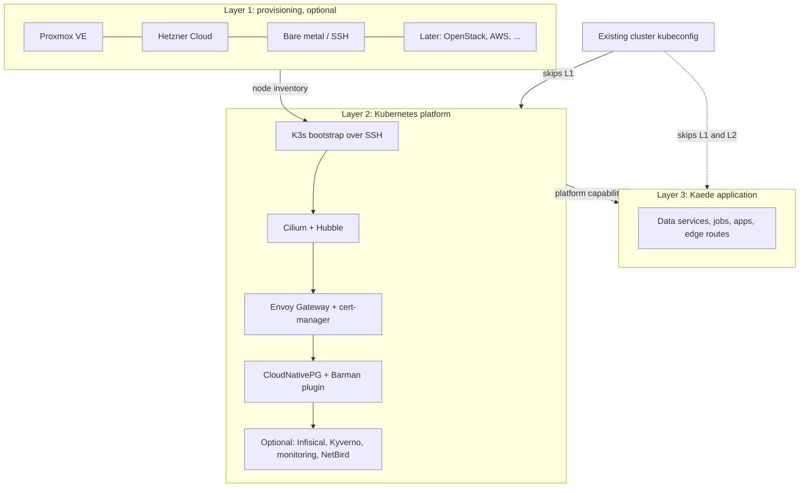
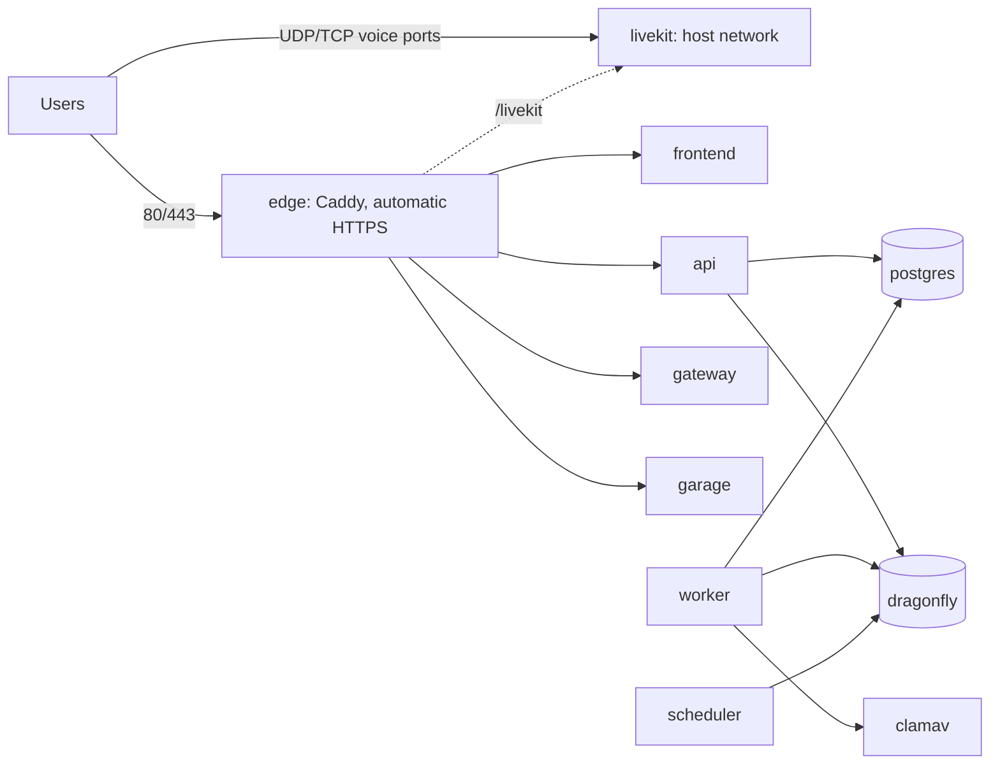
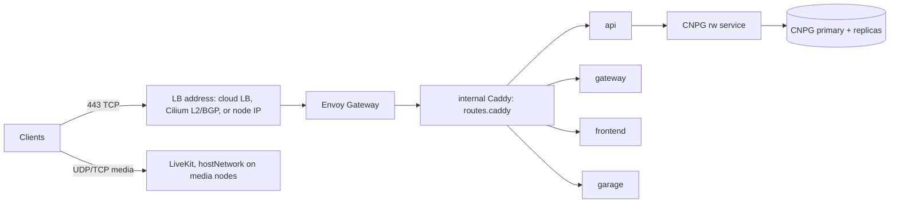
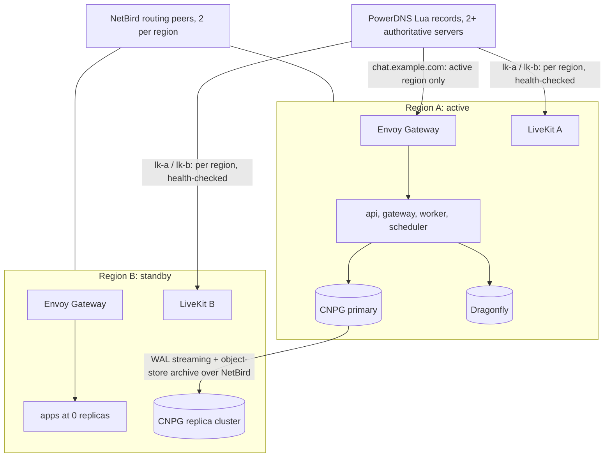

# Infrastructure modernization plan

Status: research and planning only. Nothing in this document has been
implemented, and no existing deployment, script, or workflow has changed.
Research was done on 2026-10-27. Version numbers and vendor claims reflect that
date. Items marked **(unverified)** need confirmation before anyone builds on
them.

The goal is one deployment platform with four profiles: a simple Docker
Compose install for self-hosters, a K3s and Tilt development environment,
single-region Kubernetes production, and multi-region production. All four
share images and application configuration. Infrastructure providers are
optional adapters, not dependencies.

**Recommendations at a glance**

- Keep today's Python manifest renderer as the single source of Kaede's
  Kubernetes objects. Tilt keeps consuming it directly, and Pulumi wraps the
  same output for production.
- Split the platform into three Pulumi Python layers: provisioning, Kubernetes
  platform, and application. Existing clusters skip the first layer, and
  usually the second.
- Ship the first four provider targets: existing Kubernetes, bare metal over
  SSH, Proxmox VE, and Hetzner Cloud. OpenStack (which also covers OVHcloud
  Public Cloud) and AWS come later.
- Make the frontend image instance-independent before publishing anything to
  GHCR. Today it bakes per-instance settings into the build.
- Write the new installer, `kaedectl`, in Python with Typer and line-based
  prompts. Distribute it as a PyApp single-file binary and through
  `uv tool install`. A full-screen TUI is not worth building in the first
  version.
- Use Infisical as the optional secrets backend for Standard and Global, with
  its own database and Redis-compatible store. Compose keeps a local secrets
  file by default.
- Treat Global as one writing region plus warm standby regions, with
  regional voice. PostgreSQL stays single-primary everywhere.

## 1. Current state

Production already runs on Kubernetes. Commit `d837614` ("k8s conversion")
removed `deploy/compose.yml` and its variants, leaving a small,
dependency-free Python toolchain around kubectl. There's no Pulumi, Helm, or
Kustomize. TLS lives in host nginx and Certbot outside the cluster.

| Area | Today |
|---|---|
| Renderer | [stack.py](../deploy/kubernetes/stack.py) renders every object as a `List` for production and Tilt. This is the piece to keep |
| Third-party images | Pinned by tag, not digest ([stack.py:23-34](../deploy/kubernetes/stack.py#L23-L34)). PostgreSQL is a plain `postgres:16.14-alpine` StatefulSet |
| Secrets | Per-role, from a hand-maintained [environment-keys.json](../deploy/kubernetes/environment-keys.json); preflight gets the whole `.env` ([stack.py:179-197](../deploy/kubernetes/stack.py#L179-L197)) |
| Edge | Caddyfile adapted by string replacement ([stack.py:459-474](../deploy/kubernetes/stack.py#L459-L474)); host nginx reaches the cluster through loopback `hostNetwork` bridge pods ([stack.py:498-543](../deploy/kubernetes/stack.py#L498-L543)) |
| LiveKit | `hostNetwork`, TURN certificates from host paths ([stack.py:545-607](../deploy/kubernetes/stack.py#L545-L607)) |
| Storage | One class and size for every PVC ([stack.py:666-678](../deploy/kubernetes/stack.py#L666-L678)); one node on `local-path`; manual backups ([docs/operator.md:562-578](operator.md#backup-and-restore-boundary)) |
| Images | Built locally, then imported into K3s containerd through a root-owned sudo helper or pushed to a registry ([manage.py:153-184](../deploy/kubernetes/manage.py#L153-L184)). Tags are `<revision>-<hash of all .env values>` ([manage.py:187-191](../deploy/kubernetes/manage.py#L187-L191)), so each image belongs to one instance |
| Frontend image | The build stage ([frontend/Dockerfile:40-64](../frontend/Dockerfile#L40-L64)) bakes in media and upload origins, S3 addressing style, attachment bucket, landing variant, and six legal fields. Media origins reach the hash CSP through [media-csp.mjs](../frontend/scripts/media-csp.mjs) and [vite.config.ts](../frontend/vite.config.ts). The backend image ([backend/Dockerfile](../backend/Dockerfile)) is already generic |
| CI | [ci.yml](../.github/workflows/ci.yml) builds dev images only inside disposable k3d clusters. No multi-arch, publishing, signing, SBOM, provenance, or image scanning (OSV covers lockfiles), gaps the operator guide lists ([docs/operator.md:1160-1166](operator.md#explicit-v1-operational-boundaries)). [desktop-release.yml](../.github/workflows/desktop-release.yml) already uses `v*` tags |
| Setup | [setup.sh](../setup.sh), a careful 1,700-line Bash wizard (staged writes, `.kaede-backups/`, `flock`, secret preservation, EXIT-trap restore), writes `.env`, `.kaede-kubernetes.json`, and optional nginx config |
| Updates | [auto-update.sh](../deploy/auto-update.sh) fast-forwards a clean checkout and runs `manage.py deploy --update-only` from a systemd user timer. Updates are source builds |
| Development | The [Tiltfile](../Tiltfile) drives k3d from [dev.py](../deploy/kubernetes/dev.py): K3s v1.36.4, Traefik and ServiceLB off, custom CIDRs ([dev.py:141-219](../deploy/kubernetes/dev.py#L141-L219)). It builds with `dev.py build-image`, imports into the node, and live-syncs `backend/app`, `backend/scripts`, `frontend/src`, and `frontend/static`; an optional alpha/beta federation pair runs side by side. [check.py](../deploy/kubernetes/check.py) reuses the renderer for CI |

[manage.py](../deploy/kubernetes/manage.py)'s deploy logic
([manage.py:230-439](../deploy/kubernetes/manage.py#L230-L439)) holds the
operational knowledge worth carrying forward. It refuses a cluster whose
`kube-system` UID differs from the one recorded at setup.
[migration_safety.py](../deploy/kubernetes/migration_safety.py) classifies
migrations, and anything non-additive, or any change to StatefulSets, PVCs,
or bridges, needs `MAINTENANCE=1`. The order is preflight, optional backup
hook, stateful services, migration Job, storage-init, then worker, api,
gateway, scheduler, frontend. A failed compatible rollout restores the
previous Deployment specs, and a `kaede-release` ConfigMap records what's
deployed.

`setup.sh` needs a terminal and has no non-interactive mode
([setup.sh:59-62](../setup.sh#L59-L62)). It emits a fixed key list
([setup.sh:1328-1501](../setup.sh#L1328-L1501)), so a rerun drops keys it
doesn't know: legal and landing settings, mobile keys, APNs relay keys, and
federation peer overrides. It needs Bash 4 and GNU userland (`stat -c`,
`mv -fT`, `ss`, `systemctl --user`) and assumes K3s is installed and Ready.

The architecture document's runtime topology still describes Compose
networking (data and egress bridges, `host.docker.internal`) and will need
updating. Two application facts constrain multi-region:

- Dragonfly isn't just a cache. It's the Taskiq broker (Redis Streams) and
  the authority for snowflake worker-ID leases, with a round trip on every ID
  mint ([docs/architecture.md](architecture.md#runtime-topology)).
- The instance has one federation identity, its signing key encrypted by
  `KAEDE_SECRET_KEY`. Two live copies must never talk to peers.

## 2. Profiles and layers

| | Compose | Minimal | Standard | Global |
|---|---|---|---|---|
| Purpose | Single-server self-hosting | Development with hot reload | Single-region production | Multi-region production |
| Runtime | Docker Compose | K3s in k3d, driven by Tilt | Any conformant Kubernetes (K3s preferred) | One independent cluster per region |
| Images | GHCR release, by tag and digest | Built locally | GHCR release, by digest | GHCR release, by digest |
| PostgreSQL | Plain container | CloudNativePG, one instance | CloudNativePG, 1 to N instances | CloudNativePG, plus replica clusters |
| Edge | Caddy with automatic HTTPS | Caddy NodePort on loopback | Envoy Gateway, then internal Caddy | Regional Envoy Gateway, PowerDNS steering |
| Secrets | Local file, optional Infisical | Fixture credentials | Pulumi secrets or Infisical | Infisical with a standby |
| Managed by | `kaedectl` | `make dev`, Tilt | `kaedectl`, Pulumi | `kaedectl`, Pulumi |

Profile and provider are independent. Standard on an existing cluster, a
Proxmox VM, or Hetzner uses the same application layer.



Each layer is a Pulumi project and stack, linked by stack outputs. Layer 1
emits a node inventory (addresses, SSH host keys, disks, networks). Layer 2
turns that, or an existing kubeconfig, into a cluster and publishes a
capability record, or in "detect only" mode reports missing prerequisites.
Layer 3 reads capabilities and never asks which provider is underneath.

### Shared configuration

The anchor is the application's Pydantic `BaseSettings` class with the
`KAEDE_` prefix
([backend/app/core/settings.py:99](../backend/app/core/settings.py#L99)), not
a parallel schema. Compose and Kubernetes share four things:

- a `release.json` per version listing every image (Kaede's and third-party)
  by digest, plus the minimum supported upgrade source;
- a typed service catalog of roles (image, command, ports, health endpoints,
  settings received, writer or not) that replaces the commands and probes
  hard-coded in `stack.py` and generates `environment-keys.json`;
- settings generated from `Settings` fields, tagged by role and sensitivity,
  with a CI check that fails when a new setting has no role;
- a Caddy snippet with the API, gateway, media, push, and LiveKit routes.

Storage, scaling, RBAC, network policy, service names, TLS, and node details
stay separate. The Compose file is hand-written. A CI test checks it against
the catalog's images, commands, and health checks, which is cheaper than a
universal generator.

## 3. Infrastructure providers

| Target | Pulumi Python package | Maturity | Load balancer and UDP | Storage | Fit |
|---|---|---|---|---|---|
| Existing Kubernetes | `pulumi-kubernetes` 4.34 (Pulumi) | Mature | Whatever the cluster has; detect it | Existing StorageClasses | **First release** |
| Bare metal over SSH | `pulumi-command` 1.2 (Pulumi) | Mature, low-level | Cilium LB IPAM with L2 or BGP, or MetalLB; UDP fine | Local disks, LVM, ZFS | **First release** |
| Proxmox VE | `pulumi-proxmoxve` 8.6 (community, wraps bpg 0.x) | Usable; pin both versions | None built in; same as bare metal | ZFS, LVM-thin for VM disks | **First release** |
| Hetzner Cloud | `pulumi-hcloud` 1.43 (Pulumi org) | Mature | Hetzner LB is TCP/HTTP only, so LiveKit uses node IPs | hcloud CSI volumes | **First release** |
| OpenStack | `pulumi-openstack` 5.5 (Pulumi) | Mature | Octavia; UDP support varies by cloud | Cinder CSI | Second wave |
| OVHcloud | `pulumi-ovh` 2.22 (OVH, official) | Mature | Public Cloud is OpenStack-based | Block volumes | Via OpenStack adapter |
| AWS | `pulumi-aws` 7.51, `pulumi-eks` 4.4 | Mature | NLB supports UDP | EBS CSI | Second wave |
| Google Cloud | `pulumi-gcp` 10.2 | Mature | Passthrough NLB supports UDP | PD CSI | On demand |
| Azure | `pulumi-azure-native` 3.29 | Mature | Standard LB supports UDP | Managed disks | On demand |
| DigitalOcean | `pulumi-digitalocean` 4.84 | Mature | UDP limited to 1,424-byte payloads | Volumes CSI | On demand |

Sources: [Pulumi Registry](https://www.pulumi.com/registry/),
[Hetzner LB FAQ](https://docs.hetzner.com/cloud/load-balancers/faq/),
[DigitalOcean LB limits](https://docs.digitalocean.com/products/networking/load-balancers/details/limits/),
[AWS NLB listeners](https://docs.aws.amazon.com/elasticloadbalancing/latest/network/load-balancer-listeners.html),
[bpg Proxmox provider](https://github.com/bpg/terraform-provider-proxmox).
Linode and Scaleway have maintained providers. Vultr's community provider
hasn't released in over a year. Equinix Metal shut down on 2026-06-30.

Bare metal is nearly free, since every VM adapter feeds the same SSH
bootstrap. AWS egress ($0.09/GB after the first 100 GB, per the
[EC2 pricing page](https://aws.amazon.com/ec2/pricing/on-demand/)) makes it a
poor default for media-heavy chat.

### Provider notes

| Target | Notes |
|---|---|
| Proxmox VE | No Pulumi-maintained provider; bpg's is 0.x, targets PVE 9, limited 8.x support. Cloned VMs with cloud-init need `VmLegacy` (the newer cloned-VM resource doesn't manage cloud-init). Snippets need directory storage such as `local` and SSH to upload. VM disks on ZFS or LVM-thin. No LB integration, so LoadBalancer IPs work as on bare metal. |
| Bare metal | Takes hosts, users, and pinned SSH host keys; provisions nothing. Always set `hostKey` on `remote.Command`, or the key isn't checked ([docs](https://www.pulumi.com/registry/packages/command/api-docs/remote/command/)). Ansible's `k3s.orchestration` suits Ansible shops but isn't worth a second bootstrap path. |
| Hetzner Cloud | Cheapest mature API here; LiveKit uses node Primary IPs. Prices rose for new orders on 2026-06-15 (CPX22 from €7.99 to €19.49 a month); cheap CX and CAX lines are Germany and Finland only and sometimes sold out ([price adjustment](https://docs.hetzner.com/general/infrastructure-and-availability/price-adjustment/)). Dedicated (Robot) servers have no provider; use the bare metal adapter. |
| Existing Kubernetes | First-class. Takes a kubeconfig and context, checks the cluster UID like `manage.py`, and detects the default StorageClass (expansion, snapshots), whether a probe LoadBalancer Service gets an address, Gateway API CRDs and bundle version, existing GatewayClasses, CNI, kube-proxy, NetworkPolicy enforcement, dual-stack, and whether it's K3s (for the embedded registry mirror). Missing prerequisites produce a report; nothing silently degrades. |

### Join tokens

K3s join tokens never go in cloud-init user data. User data stays on disk and
can often be read back through the provider API or metadata service
([AWS](https://docs.aws.amazon.com/AWSEC2/latest/UserGuide/user-data.html)), and
Proxmox snippets are plaintext on the host. Instead, generate server and agent
tokens with `pulumi_random` as Pulumi secrets, and push them over SSH (pinned
host key) into `0600` files referenced by `token-file`. Use the secure
`K10<CA hash>::` format with a separate `agent-token`, and short-lived
`k3s token create` tokens for nodes added later
([K3s token docs](https://docs.k3s.io/cli/token)).

## 4. Pulumi design

### Capability contract

Providers declare what they can do through typed models, and the upper layers
consume nothing else. A rough shape, in Pydantic v2 (already a backend
dependency):

```python
class StorageOffer(BaseModel):
    storage_class: str
    node_local: bool            # local-path, TopoLVM, OpenEBS LVM/ZFS
    enforces_capacity: bool     # local-path does not
    expandable: bool
    snapshots: bool             # CSI VolumeSnapshot support

class LoadBalancerOffer(BaseModel):
    kind: Literal["cloud", "cilium-l2", "cilium-bgp", "metallb", "node-ip", "none"]
    udp: bool                   # False on Hetzner LB, partial on DigitalOcean
    ipv6: bool
    preserves_client_ip: bool

class Node(BaseModel):
    name: str
    address: IPvAnyAddress
    ssh_host_key: str
    roles: set[Literal["server", "agent", "media"]]
    zone: str | None

class ProvisionedRegion(BaseModel):
    region: str
    nodes: list[Node] | None    # None when the provider returns a cluster
    kubeconfig: SecretStr | None
    pod_cidr: IPv4Network
    service_cidr: IPv4Network
    load_balancer: LoadBalancerOffer
    storage: list[StorageOffer]
    limitations: list[str]      # shown to the operator, never hidden

class Provisioner(Protocol):
    name: ClassVar[str]
    def validate(self, spec: RegionSpec) -> list[Problem]: ...
    def provision(self, spec: RegionSpec) -> ProvisionedRegion: ...  # runs inside a Pulumi program
```

`kaedectl` prints `limitations` (such as "no PostgreSQL failover" on one
node) before deploying, and the application layer rejects settings that
contradict them, like three database instances on node-local storage in a
one-node cluster.

### Components

All Pulumi code is `ComponentResource` classes in one package,
`kaede_deploy`:

- **Layer 1:** `ProxmoxRegion`, `HetznerRegion`, `BareMetalRegion`, each
  returning a `ProvisionedRegion`.
- **Layer 2:** `K3sCluster` bootstraps over SSH and writes
  `/etc/rancher/k3s/config.yaml` with `flannel-backend: none`,
  `disable-network-policy`, `disable-kube-proxy`,
  `disable: [traefik, servicelb]`, `embedded-registry: true`, and
  `secrets-encryption: true`. These are set at first boot, because disabling
  Traefik later removed the Gateway API CRDs on K3s releases before April
  2026 ([K3s networking](https://docs.k3s.io/networking/networking-services)).
  Then `Cilium` (Hubble, LB IPAM pools, L2 or BGP announcements),
  `EnvoyGateway`, `CertManager`, `CloudNativePG` (operator plus Barman Cloud
  plugin), and optional services.
- **Layer 3:** `KaedeInstance`, taking the instance configuration, a release
  manifest, and the capability record.

`KaedeInstance` doesn't build objects itself. It calls the renderer Tilt uses
(today `stack.render()`, later `kaede_deploy.render`) and wraps the output in
`pulumi_kubernetes.yaml.v2.ConfigGroup` groups ordered data services, jobs,
then applications. `deploy/tests` keeps checking manifests as plain
dictionaries. Third-party charts use `helm.v4.Chart`. Pulumi's docs disagree
on `Chart` versus `helm.v3.Release` for production
([tutorial](https://www.pulumi.com/dev/tutorials/choosing-the-right-helm-resource/)
versus the [Chart page](https://www.pulumi.com/registry/packages/kubernetes/api-docs/helm/v4/chart/)).
Use `Chart` unless a chart depends on Helm hooks **(unverified per chart)**.

### Release orchestration

Kaede's rollout isn't declarative, so the management layer keeps it and
drives Pulumi through the Automation API:

1. Run the migration safety check and preflight against the target release.
2. Run `stack.preview()`. Replacing a CNPG `Cluster`, PVC, or StatefulSet
   stops the run unless maintenance was requested. This replaces today's
   infrastructure digest with a more precise check.
3. Call the backup hook. In maintenance mode, `up` with writers at zero, then
   `up` with the new release.
4. The migration Job's name includes the schema digest. Deployments depend on
   it and on each other in today's order, and Pulumi waits for each rollout.
5. On failure, `up` again with the previous release manifest, kept as a stack
   output.

`kaedectl` uses `LocalWorkspace` on Pulumi projects shipped in its package,
not inline programs, so operators can still run `pulumi preview` by hand.
Engine events stream into its output in plain language. Leave out the Pulumi
Kubernetes Operator v2 for now: its examples assume Pulumi Cloud, and it puts
cloud and cluster credentials inside the cluster it manages.

### State, secrets, runtime, testing

| Concern | Design |
|---|---|
| State | S3-compatible DIY backend (`s3://bucket?endpoint=...&s3ForcePathStyle=true`), or `file://` on the management host for single-admin installs ([backends](https://www.pulumi.com/docs/iac/concepts/state-and-backends/)). Never in the object store of the cluster it describes. DIY locking isn't transactional, so `kaedectl` keeps its own `flock`. Pulumi Cloud is optional |
| Secrets provider | `passphrase` by default, in a `0600` file with an offline copy; `hashivault://` (works with OpenBao) or a cloud KMS on request. Pulumi ESC needs Pulumi Cloud, so it's optional |
| Commands | `kaedectl plan` is `preview`; `deploy` is the orchestration above; `rollback` redeploys the previous manifest and never downgrades the schema. Crash recovery is `pulumi refresh`, then `pulumi cancel` for a stale lock |
| Runtime | `runtime: {name: python, options: {toolchain: uv}}` and `typechecker: mypy` ([Python docs](https://www.pulumi.com/docs/iac/languages-sdks/python/)); `kaedectl` pins the CLI with `PulumiCommand.install(version=...)` |
| Tests | `pulumi.runtime.set_mocks` under pytest via `@pulumi.runtime.test` (Pulumi documents unittest) **(unverified on current SDK)**; the golden manifest tests in [deploy/tests/test_kubernetes.py](../deploy/tests/test_kubernetes.py), extended; a CI job running layers 2 and 3 against k3d as an existing cluster, and an optional nightly Hetzner job that costs money. Ruff and strict mypy as in the backend. CrossGuard policy packs run locally with `pulumi preview --policy-pack` on any backend |

### Optional platform services

| Service | Compose | Minimal | Standard | Global | Notes |
|---|---|---|---|---|---|
| cert-manager | No (Caddy does ACME) | No | Required | Required | The Barman Cloud plugin needs it |
| CloudNativePG + Barman plugin | No | Yes | Yes | Yes | In-tree Barman is removed in CNPG 1.31 |
| Infisical | Optional, external | No | Optional | Recommended | See below |
| External Secrets Operator | No | No | Optional | Optional | Only if using a non-Infisical store |
| Kyverno | No | No | Recommended | Recommended | Image signature checks |
| Prometheus, Grafana, Loki | Optional profile | No | Optional | Recommended | Keep today's bundled dashboards |
| Tempo, OpenTelemetry | No | No | Optional | Optional | Needs backend instrumentation first |
| Proxmox Backup Server | Host-level | No | If on Proxmox | If on Proxmox | VM-level, not database-consistent |
| K3s etcd snapshots | No | No | Yes | Yes | Off-cluster S3 target |

### Infisical

Self-hosted Infisical has no identity or user limits, and single-region HA is
free: stateless replicas, PostgreSQL on CloudNativePG (as in Infisical's own
[Kubernetes HA reference](https://infisical.com/docs/self-hosting/reference-architectures/on-prem-k8s-ha)),
and Redis through Sentinel. An enterprise license is needed for active
multi-region replicas
([replication guide](https://infisical.com/docs/self-hosting/guides/replication)),
audit logs, PITR, custom roles, SSO or LDAP, approvals, rotation, dynamic
secrets, IP allowlisting, HSM or external KMS for the root key, and the
operator's instant updates.

| Concern | Design |
|---|---|
| Placement | Own namespace, CloudNativePG cluster, and Redis or Valkey. Not Kaede's Dragonfly: Infisical's BullMQ queue only uses the key prefixes Dragonfly needs in cluster mode, so it would need a global-lock Lua flag, an untested combination |
| Delivery | The operator syncs one `InfisicalStaticSecret` per role into Kaede's per-role Secrets. Per-role key subsets through templates are **(unverified)**; otherwise use one Infisical folder per role |
| Outages | On a failed sync the operator keeps the last-written Secrets (from source, not documented), so Kaede can restart while Infisical is down |
| Root keys | `ENCRYPTION_KEY` and `AUTH_SECRET` can't live in Infisical. Pulumi generates them as stack secrets and `kaedectl` exports an offline copy; without `ENCRYPTION_KEY` a database restore can't be decrypted |
| Global | One primary plus a standby promoted with the CNPG replica cluster: active-passive and free |
| Compose | Infisical wants 4 to 8 GB of RAM, roughly doubling a small server. Compose keeps a local file; `kaedectl secrets pull` reads an external Infisical |

If audit logs become a hard requirement before a license is affordable,
OpenBao (MPL-2.0, free Raft HA) is the fallback, at higher operating cost.

## 5. Repository layout

```text
deploy/
  kaede_deploy/                 # one Python package, uv-managed (pyproject.toml, uv.lock)
    config/                     # Pydantic models: instance, profiles, providers, release manifest
    catalog.py                  # service catalog (roles, commands, ports, probes, writer flag)
    render/                     # Kubernetes object renderer (refactored stack.py)
    release/                    # migration safety, preflight, ordered rollout, rollback
    compose/                    # Compose backend: upgrade, backup, restore, doctor
    providers/                  # existing, baremetal, proxmox, hetzner (later: openstack, aws)
    platform/                   # K3s, Cilium, Envoy Gateway, cert-manager, CNPG, optional services
    app/                        # KaedeInstance component
    cli/                        # kaedectl (Typer)
  pulumi/
    provision/Pulumi.yaml       # layer 1 program: selects a provider adapter
    platform/Pulumi.yaml        # layer 2 program
    kaede/Pulumi.yaml           # layer 3 program
  compose/
    compose.yaml                # hand-written, images pinned by the release manifest
    caddy/                      # Compose edge site blocks
  caddy/
    routes.caddy                # shared application routes (Compose and Kubernetes)
    internal.caddy              # Kubernetes internal edge (auto_https off, edge secret)
  kubernetes/                   # kept as thin shims during migration (dev.py, check.py, manage.py)
  tests/                        # existing tests, plus Pulumi mocks and Compose parity tests
.github/workflows/
  server-release.yml            # build, sign, attest, scan, publish, release manifest
```

`deploy/kubernetes/*.py` stays until its logic has moved, so `make dev`,
`make check`, and production deploys keep working, and the Tiltfile keeps
calling `dev.py`. The `pyproject.toml` ends the "standard library only" rule:
the scripts run through uv instead of any `python3`.

## 6. Docker Compose

Compose returns for one-server installs. Unlike the old topology
(`git show d837614^:deploy/compose.yml`), it pulls release images, terminates
TLS itself, and is managed by `kaedectl`.



| Part | Design |
|---|---|
| Services | `edge`, `frontend`, `api`, `gateway`, `worker`, `scheduler`, `postgres`, `dragonfly`, and `clamav` always run. Garage, Meilisearch, LiveKit, and observability are Compose profiles. `preflight`, `migrate`, and `storage-init` are one-shot services run with `docker compose run --rm` |
| Networks | An `internal: true` `data` network for PostgreSQL, Dragonfly, Garage, ClamAV, and Meilisearch. Only roles needing federation, email, or push traffic join `egress`, as the architecture document describes |
| Edge | Caddy owns 80 and 443 with ACME, imports `routes.caddy`, and keeps the security headers, so there's no host nginx or Certbot. Operators with nginx can bind the edge to loopback as today |
| LiveKit | Keeps `network_mode: host` and its five ports. TURN/TLS reads its certificate read-only from Caddy's data volume. Renewals don't restart LiveKit, so `kaedectl` installs a renewal check that does **(approach to validate)** |
| Per-role environment | `kaedectl` writes `env/<role>.env` from the catalog, keeping the Kubernetes secret split: the gateway never sees `KAEDE_SECRET_KEY`, and the scheduler gets only the broker URL |
| Images | `ghcr.io/<org>/kaede-backend:v1.4.2@sha256:...` from the release manifest; tag plus digest stays readable and pulls exactly |
| PostgreSQL | The official image, not CloudNativePG. Using the Debian variant avoids a collation mismatch later (section 10) |

### Lifecycle

| `kaedectl` command | Behavior |
|---|---|
| `init` | Asks for domain, email provider, storage, and optional features; checks DNS and that 80 and 443 are free; writes `kaede.yaml` and `secrets.env`; pulls, runs preflight, migrates, starts, and prints the owner-account command |
| `config set`, `config edit`, `apply` | Validate against the Pydantic models; `apply` recreates only changed containers |
| `upgrade` | Verifies the next signed release manifest and the upgrade path, pulls, and runs preflight and the migration plan from the new backend image, so classification moves from `deploy/kubernetes/migration_safety.py` into a `kaede migration-plan` command. Additive migrations get backup, migrate, and recreate in rollout order; anything else needs `--maintenance` |
| `backup` | One format for every profile: custom-format `pg_dump`, Dragonfly snapshot, S3-API copy of the three buckets (works for Garage and external S3, avoids Garage's stop-the-world metadata copy), `kaede.yaml`, secrets file, checksum manifest. Age-encrypted, stored locally and ideally on off-host S3 or restic; `backup schedule` installs a timer |
| `restore` | Empty installs only; checks domain and `KAEDE_SECRET_KEY` match; holds writers until import finishes. The same archive restores into Standard, which is the supported Compose-to-Kubernetes path |
| `doctor`, `logs <role>`, `support-bundle` | Check DNS, 80 and 443 reachability, certificate expiry, container health, disk, clock skew, migrations at head, and LiveKit's TCP ports, each with a suggested fix; collect logs with credentials redacted |

A compatible upgrade costs a few seconds per single-replica service plus
WebSocket reconnects; maintenance upgrades stop writers for the migration.
The `legacy.py` export path keeps working for pre-Kubernetes Compose
installs.

## 7. Tilt compatibility

Every refactor phase must end with `make dev`, `make dev-federation`, and the
acceptance checks working unchanged. The k3d setup (one server, per-checkout
names, loopback ports, dev CIDRs, flannel), `custom_build` with
`skips_local_docker`, `live_update` syncs and `fall_back_on` lists, the
hot-reload commands (`uvicorn --reload`, Taskiq `--reload`, `watchfiles`),
`make dev-down` stopping rather than deleting, and the federation pair all
stay. What changes:

- **Entry point:** once the renderer needs Pydantic, the Tiltfile calls
  `uv run --project deploy deploy/kubernetes/dev.py ...` instead of
  `python3`. `make tools` installs a pinned uv with kubectl, k3d, and Tilt.
- **CloudNativePG in dev:** `dev.py cluster` installs the operator once and
  runs a one-instance `Cluster` with `enablePDB: false`, so dev uses the same
  database objects as production. Tilt groups CNPG pods with
  `k8s_kind('Cluster', pod_readiness='wait')`, and `migrate-<ns>` depends on
  that group instead of `postgres-<ns>`. `kaedectl dev migrate-db` moves
  existing dev data by dump and import. The plain StatefulSet stays behind a
  flag for one release.
- **Optional parity:** `make dev CNI=cilium` creates a node with
  `flannel-backend: none`, the bpffs mount, and Cilium. `make dev EDGE=envoy`
  puts Envoy Gateway in front of the internal Caddy. Neither is default; both
  slow cluster creation without affecting hot reload. Cilium on k3d needs
  extra node mounts **(unverified on k3d 5.8)**.
- **CI:** a job runs `tilt ci` against a fresh k3d cluster.

Development never needs GHCR, Pulumi, Infisical, or monitoring. Release
images can be tested with `kaedectl` against the dev cluster as an existing
cluster.

## 8. Release images: GHCR and Spegel

### Prerequisite: instance-independent images

1. **Runtime public configuration.** The landing variant, legal fields, media
   and upload origins, bucket, and addressing style leave the build. The SPA
   reads them at startup from a public configuration endpoint, like the ones
   the backend already serves
   ([backend/app/api/auth.py:291](../backend/app/api/auth.py#L291)). That
   beats a `config.json` written by the frontend entrypoint, because
   `deploy/validate_deploy_env.py` has validation to reuse. The landing and
   legal fields must join backend `Settings`; today only
   `KAEDE_LEGAL_CONTACT_EMAIL` reaches the API.
2. **CSP split.** The SvelteKit meta CSP keeps the script hashes and drops
   media origins from `connect-src`, which the edge sends as a header built
   from runtime settings. Browsers enforce every policy present, so the meta
   policy must not also restrict `connect-src`. `verify-csp.mjs` and
   `media-csp.mjs` must check the combined result.
3. **Tags.** Tags become the release version. The configuration hash in
   [manage.py:187-191](../deploy/kubernetes/manage.py#L187-L191) goes away;
   configuration changes roll pods through Secret and ConfigMap name digests,
   as the renderer already does.

The custom landing page's legal text would then render client-side. If
crawlers must see it, the frontend container can template the HTML at start
instead **(decision needed)**.

### Publishing

A new `server-release.yml` runs on version tags, either sharing `v*` with the
desktop workflow or using `server-v*` **(decision needed)**.

| Step | Detail |
|---|---|
| Build | `kaede-backend` and `kaede-frontend` for `linux/amd64` and `linux/arm64` with Buildx. Backend arm64 dependencies (ffmpeg, libvips, rembg/ONNX runtime wheels) need checking **(unverified)** |
| Attest | BuildKit SBOM and provenance (`--sbom=true --provenance=mode=max`), plus GitHub attestations through `actions/attest@v4` ([repo](https://github.com/actions/attest)) |
| Sign | Keyless cosign with the workflow's OIDC identity. Cosign v3 writes the new bundle format by default ([announcement](https://blog.sigstore.dev/cosign-3-0-available/)) |
| Scan | `osv-scanner scan image`, keeping one scanner in the repo; fail on unignored high-severity findings |
| Mirror | Pinned third-party images (PostgreSQL, Dragonfly, Garage, ClamAV, Meilisearch, Caddy, LiveKit, monitoring) into `ghcr.io/<org>/mirror/*` by digest, avoiding Docker Hub rate limits and keeping old releases installable |
| Publish | A signed `release.json` with every digest, and the `kaedectl` binaries |

Images should be public. Anonymous GHCR pulls need no credentials, and
public package storage and bandwidth are currently free
([GitHub Packages billing](https://docs.github.com/en/billing/concepts/product-billing/github-packages)).
Forks with private images need a machine account with a classic token
limited to `read:packages`, because GHCR rejects fine-grained tokens
([GHCR docs](https://docs.github.com/en/packages/working-with-a-github-packages-registry/working-with-the-container-registry)).
Keep every release digest forever, and delete untagged dev builds after 30
days with `actions/delete-package-versions`. That can remove per-platform
manifests and attestations that release indexes point to **(test before
enabling)**.

Clusters verify signatures with Kyverno `ImageValidatingPolicy`, starting in
audit mode; the older `verifyImages` rule is deprecated in 1.19 and removed
in 1.20
([Kyverno 1.19](https://kyverno.io/blog/2026/08/20/announcing-kyverno-release-1.19/)).
Bundle-format compatibility has had reported problems **(unverified
report)**, so a CI test checks exact cosign output against the exact Kyverno
version.

### Image distribution

| Platform | Approach |
|---|---|
| K3s | Embedded registry mirror (`embedded-registry: true`) with `registries.yaml` mirrors for `ghcr.io` and `docker.io` on every node; GA since v1.29.12, v1.30.8, and v1.31.4. Peers use TCP 5001 and 6443 inside the cluster only ([K3s registry mirror](https://docs.k3s.io/installation/registry-mirror)). Deploy by digest: `latest` isn't shared, and digests can't be poisoned by a compromised node. Private images reach peers without upstream credentials, another reason to stay public |
| Other distributions | Standalone Spegel on containerd with `config_path` and `discard_unpacked_layers=false`. AKS works directly; EKS and GKE need node configuration ([Spegel docs](https://spegel.dev/docs/getting-started/)). Otherwise a Zot or Harbor pull-through cache per region covers GHCR outages. Managed clusters near a cloud registry may need neither |
| Compose | Local Docker store. `kaedectl images export` writes an offline bundle for air-gapped installs |

## 9. Networking and multi-region

### Single region (Standard)



| Component | Design |
|---|---|
| Cilium 1.20 | Replaces kube-proxy, with Hubble relay on and the UI optional, on K3s started with the section 4 flags ([Cilium on K3s](https://docs.cilium.io/en/stable/installation/k3s/)). LoadBalancer addresses come from the cloud LB, or Cilium LB IPAM announced by L2 (small sites) or BGP (where there's a router) |
| Envoy Gateway 1.9 | Needs the Gateway API v1.6 CRDs. Owns public TLS through cert-manager's Gateway support. Cilium's Gateway API implementation stays disabled (the default), with the CRDs installed once ([Cilium Gateway API](https://docs.cilium.io/en/stable/network/servicemesh/gateway-api/gateway-api/)); neither project documents running both |
| Client addresses | Envoy Gateway defaults to `externalTrafficPolicy: Local`, which Cilium L2 announcements don't support. With L2, set `Cluster` in `EnvoyProxy`, fine on one node. On several nodes, use Cilium DSR, BGP with `Local`, or PROXY protocol from a cloud LB **(DSR behavior to verify)**. Rate limits depend on correct `X-Forwarded-For` |
| Internal Caddy | Keeps every route and security header, loaded from `routes.caddy`. Porting the media `forward_auth` gate and header sanitization to Envoy `SecurityPolicy` would be a risky rewrite with no user benefit. A Cilium NetworkPolicy lets only Envoy pods reach Caddy. The edge secret stays for defense in depth, though its value would live in an `HTTPRoute` header filter rather than a Secret **(decision needed)** |
| Rate limits | nginx's per-address limits on `/gateway` upgrades and `/_kaede/v1/link` move to Envoy local rate limiting, which needs no Redis. Global rate limiting would, and Dragonfly as its backend is untested |
| WebSockets | Envoy Gateway enables upgrades on every HTTPRoute. Set idle and stream timeouts above the gateway heartbeat interval, since the defaults weren't checked **(unverified)**. The 30-second gateway `preStop` and client resume cover rollouts |
| LiveKit | Stays off Envoy, whose UDPRoute hides the client address. Keeps `hostNetwork` on media-labelled nodes with the node's public address, per the [LiveKit Kubernetes guide](https://docs.livekit.io/home/self-hosting/kubernetes/). The TURN certificate becomes a cert-manager `Certificate` mounted from a Secret, and renewal triggers a restart. Several nodes in a region need shared Redis, and a room must fit on one node ([distributed setup](https://docs.livekit.io/transport/self-hosting/distributed.md)). Dragonfly as LiveKit's Redis is **(unverified)** |
| IPv6 | Dual-stack is fixed at cluster creation (dual CIDRs on every server, `ipv6.enabled` in Cilium). Per region, off by default; publish AAAA only when the edge answers on IPv6 |

| Address plan | Region *n* (1 to 9) | Dev (k3d) |
|---|---|---|
| Pod CIDR (IPv4) | `10.10n.0.0/16` (10.101, 10.102, ...) | `10.52.0.0/16` |
| Service CIDR | `10.20n.0.0/16` | `10.53.0.0/16` |
| Inter-region LB pool | `10.10n.255.0/24` carved from a node-routable range | n/a |
| IPv6 (optional) | One random ULA /48 per installation, /56 per region | n/a |
| Cilium cluster ID | *n* | n/a |

Distinct ranges cost nothing now and keep Cluster Mesh and NetBird routing
open later.

### Global

The write path can't be split by region (section 1), so Global is **one
active region plus warm standbys**, with regional voice as the latency win.



| Concern | Design |
|---|---|
| Application hostname | `chat.example.com` returns the active region's ingress addresses, health-checked with `ifurlup` against `/health/ready`. `kaedectl region promote` sets the active region through the PowerDNS API, never health checks alone, which could route users to a region with writers off or create two writers after a partition |
| Voice | Each region runs LiveKit with its own Redis. Self-hosted regions don't relay media to each other; that's a LiveKit Cloud feature, per a community answer **(unverified)**. The API would pick a region per room and return its URL; today there's one `KAEDE_VOICE_PUBLIC_URL`, so this is an application change. `lk-<region>` names use `ifportup` checks |
| Inter-region links | Carry CNPG streaming, Garage RPC if Garage spans regions, Infisical's standby database, LiveKit webhooks to the active API, and metrics. NetBird Networks with two routing peers per region (metric-ordered failover) advertise each region's inter-region LB pool; pods don't join NetBird. Masquerading hides source addresses, so CNPG replication uses TLS client certificates. Routing peers clamp TCP MSS because WireGuard's 1,280-byte default MTU is below pod and node MTUs ([NetBird site-to-site](https://docs.netbird.io/manage/networks/use-cases/site-to-site)) |
| NetBird licensing | Client BSD-3; management, signal, and relay AGPLv3, with active-active HA enterprise-only. One self-hosted management server is acceptable, since tunnels keep working while it's down though peers can't change **(behavior during management outage unverified)**. The hosted service is an alternative |
| PowerDNS Authoritative 5.1 | `enable-lua-records`, the GeoIP backend with an MMDB database (DB-IP Lite or MaxMind GeoLite2), and `edns-subnet-processing=yes` ([Lua records](https://doc.powerdns.com/authoritative/lua-records/index.html)). TTLs of 30 to 60 seconds. DNSSEC needs live signing, since pre-signed zones can't use Lua records. Each server health-checks independently, so servers can disagree for a few seconds. Many resolvers don't send client subnets, so `pickclosest` often locates the resolver, not the user |
| Cluster Mesh | Not in this design. It needs every node reachable on its InternalIP, which NetBird masquerading breaks unless each node is a peer **(unverified)** |

On failover, WebSocket clients usually see no FIN; heartbeats detect the
loss, then clients reconnect with backoff and resume. DNS-steered names take
about one to two minutes (detection, TTL, resolver and browser caches), plus
the manual promotion in section 10. Calls rebuild in another region when
clients rejoin. Losing a standby doesn't affect the active region, and a
NetBird partition grows replication lag without triggering promotion.

## 10. CloudNativePG and storage

Target CloudNativePG 1.30 on PostgreSQL 16, today's major version. Major
upgrades come later through CNPG's offline in-place upgrade
([upgrades](https://cloudnative-pg.io/docs/1.30/postgres_upgrades/)).

| Profile | Instances | Replication | Backups |
|---|---|---|---|
| Minimal | 1, `enablePDB: false` | None | None |
| Standard, one node | 1 | None | Barman Cloud plugin to off-host S3, WAL archive, PITR |
| Standard, 3+ nodes | 3, spread across nodes | `synchronous: {method: any, number: 1}` | Same, plus volume snapshots if the CSI driver supports them |
| Global | 3 in the active region, 1 to 3 in each standby | Replica clusters via `spec.replica` distributed topology | Each region archives to its own bucket |

| Concern | Design |
|---|---|
| Backups | Barman Cloud plugin from day one; in-tree `barmanObjectStore` is deprecated and scheduled for removal in 1.31 ([release notes](https://github.com/cloudnative-pg/cloudnative-pg/blob/main/docs/src/release_notes/v1.30.md)). The plugin needs cert-manager. Backups go to a different failure domain than the database, which rules out bundled Garage on a single node |
| Synchronous replication | With three instances, `dataDurability: required` gives zero data loss and survives losing one standby ([replication](https://cloudnative-pg.io/docs/1.30/replication/)). Two instances should use `preferred` or stay async, or one failure blocks writes |
| Pooling | Migrations connect directly to the `-rw` Service. A PgBouncer `Pooler` is optional and starts in session mode: asyncpg's prepared statements need PgBouncer's prepared-statement support or a disabled statement cache in transaction mode, and Alembic and partition maintenance take advisory locks ([partitions.py:58](../backend/app/db/partitions.py#L58)) |
| In-region failover | Automatic. CNPG 1.30 adds a Lease-based promotion gate, and the isolation check restarts a primary that reaches neither the API server nor its peers ([failover](https://cloudnative-pg.io/docs/1.30/failover/)). Set `smartShutdownTimeout` low so an isolated primary stops committing quickly |

### Cross-region promotion

CNPG never promotes across clusters on its own. `kaedectl region` wraps the
documented procedure
([replica clusters](https://cloudnative-pg.io/docs/1.30/replica_cluster/)).

**Planned switchover** (no data loss):

1. Put the active region in maintenance: writers to zero, federation egress
   blocked.
2. Set `spec.replica.primary` on the current primary to the target and wait
   for `.status.demotionToken`.
3. On the target, set `primary` to itself and `promotionToken` to the token
   in one change.
4. Point the application record at the target, start writers, leave
   maintenance.

**Disaster promotion** (active region unreachable):

1. Confirm the old region is gone or fenced. Revoke its NetBird routes and
   remove it from DNS so it can't rejoin as a writer.
2. Promote without a token, accepting data loss equal to replication lag.
3. Start writers, then rebuild the old region as a replica before it
   reconnects to anything. This is mandatory with one federation identity.

Losing Dragonfly state on promotion is acceptable. Worker-ID leases
re-quarantine for 60 seconds on a cold start, and email is outbox-backed and
swept every minute. Whether every Taskiq job type has a database-backed sweep
is an open decision (section 13).

### Migrating today's database

Move off the `postgres:16.14-alpine` StatefulSet with `initdb.import`
(`type: microservice`), which runs `pg_dump` and `pg_restore` from the new
cluster ([import](https://cloudnative-pg.io/docs/1.30/database_import/)). No
physical copies: CNPG images are Debian/glibc and the current one is
Alpine/musl, so collations differ. A logical import rebuilds every index; a
physical copy would leave text indexes silently wrong. Downtime scales with
database size. Large instances can use a schema-only import plus logical
replication.

### Storage

CNPG recommends node-local storage with database-level replication, not
storage-level replication
([architecture](https://cloudnative-pg.io/docs/1.30/architecture/)), which
fits the no-Ceph, no-Longhorn constraint.

| Option | Where | Enforces size | Snapshots | Use for |
|---|---|---|---|---|
| K3s local-path | Any K3s node | No | No | Single node, dev |
| TopoLVM / OpenEBS LocalPV LVM | Bare metal, Proxmox VMs with a spare disk | Yes | Thin LVM only | Multi-node Standard |
| OpenEBS LocalPV ZFS | ZFS hosts | Yes | Yes | Hosts already on ZFS |
| Provider CSI (hcloud, EBS, Cinder) | Clouds | Yes | Varies | Cloud regions |
| Existing StorageClass | Existing clusters | Varies | Varies | Detected, not assumed |

The renderer gains per-volume classes and sizes, since PostgreSQL, Garage,
and Meilisearch need different sizes. Check the bundled
local-path-provisioner: CVE-2025-62878 affects releases before v0.0.34.

Object storage stays S3-compatible. Single-node Standard keeps single-node
Garage. Multi-node Standard can run Garage on three nodes with replication
factor 3, its normal mode. Global either stretches Garage across regions as
zones (write latency follows the inter-region round trip) or uses external S3
with its own replication **(decision needed)**.

| Failure | Compose | Standard, one node | Standard, 3+ nodes | Global |
|---|---|---|---|---|
| Lost node | Outage; restore from backup | Outage; restore from backup or rebuild the node | CNPG fails over in under a minute; Garage keeps quorum; the pod on the lost node stays Pending until `kubectl cnpg destroy` and a re-clone | Same as Standard within the region |
| Lost volume | Restore from backup | Restore; PITR from the WAL archive | Replica re-cloned from the primary | Same |
| Corruption | Restore from backup | PITR to before the corruption | PITR into a new cluster, then switch | Same; replicas copy corruption, so PITR is the fix |
| Lost region | n/a | n/a | n/a | Manual disaster promotion; RPO equals replication lag |

## 11. Installer (`kaedectl`)

### Language choice

Pulumi needs a Python interpreter on any host running Python programs,
whatever the installer is written in
([Python SDK](https://www.pulumi.com/docs/iac/languages-sdks/python/)). A Go
or Rust binary is dependency-free on Compose hosts but still has to get
Python onto Pulumi hosts.

| | Go: Cobra + Huh (+ Bubble Tea) | Rust: clap + inquire (+ Ratatui) | Python: Typer + Rich (+ Textual) |
|---|---|---|---|
| Versions (Oct 2026) | Bubble Tea 2.1, Huh 2.0.3, Cobra 1.10 | Ratatui 0.30 (pre-1.0), clap 4.6, inquire 0.9 | Typer 0.27, Textual 8.2 |
| Distribution | goreleaser, static binaries for every target | cargo-dist, static musl builds | PyApp single file with embedded CPython, or `uv tool install` |
| Startup | Instant | Instant | Slower; first run unpacks or downloads Python |
| Runtime deps | None, except Python for Pulumi | Same | Python, provided by PyApp or uv |
| TUI accessibility | Huh has a documented accessible mode that falls back to plain prompts | No statement found | Textual's screen reader support is unchecked on its roadmap |
| Docker / Kubernetes | Native SDKs, or shell out | kube-rs, or shell out | Shell out to `docker compose`; kubernetes client or Pulumi |
| Pulumi Python | Automation API drives Python projects across languages | No Automation API; shell out to the CLI | Same language as the infrastructure code; share Pydantic models |
| Testability | teatest (still experimental) | TestBackend | pytest, Textual pilot and snapshots |
| Main cost | Two languages; config models duplicated across a language boundary | Highest effort; no Automation API | Bigger download, slower cold start |

Sources: [Bubble Tea](https://pkg.go.dev/charm.land/bubbletea/v2?tab=versions),
[Huh](https://github.com/charmbracelet/huh),
[Pulumi Automation API](https://www.pulumi.com/docs/iac/concepts/automation-api/),
[PyApp](https://ofek.dev/pyapp/latest/config/distribution/),
[uv Python downloads](https://docs.astral.sh/uv/concepts/python-versions/),
[Textual roadmap](https://raw.githubusercontent.com/Textualize/textual/main/docs/roadmap.md).
Pulumi's Rust SDK is experimental, with no Automation API
([announcement](https://www.pulumi.com/releases/changelog/2026-08-18-experimental-rust-support/)).

The deciding factor is one configuration model shared with the Pulumi
programs; Go would duplicate validation in two languages. The cost is a
bigger first download and slower start, kept to one file with no first-run
network access by PyApp's embedded interpreter. Binary size is
**(unmeasured)**. If Compose dominates and Pulumi stays niche, revisit this
with a Go front end over a Python core.

Line-based prompts suit a sequence of questions and work with screen readers,
scripts, SSH, and copy-paste troubleshooting; a Textual `kaedectl tui` can
come later. Prompts use Rich for text, confirmation, and hidden input.
questionary hasn't released in over a year, so selection lists use
`prompt_toolkit` directly or a small wrapper.

### Architecture

```text
kaedectl (Typer commands, prompts, output formatting)
  └── kaede_deploy.config     Pydantic models, schema versions, migration of old files
  └── kaede_deploy.release    release manifests, signatures, migration plans, preflight
  └── backends
        ├── compose           docker compose (shell out), backup/restore, doctor
        └── kubernetes        Pulumi Automation API over the three layer projects
              └── providers   existing, baremetal, proxmox, hetzner, ...
```

The presentation layer only asks and prints. Each command is a function
taking a validated configuration object, so interactive and scripted runs
share code, and deployment logic stays in `compose.yaml`, the renderer, and
the Pulumi components.

| Area | Commands |
|---|---|
| Setup | `init`, `config validate`, `config show`, `config set`, `config import` |
| Deploy | `plan`, `deploy [--maintenance]`, `upgrade [--to VERSION]`, `rollback`, `status` |
| Operations | `logs`, `exec`, `doctor`, `support-bundle` |
| Data | `backup create`, `backup list`, `backup schedule`, `restore` |
| Secrets | `secrets generate`, `secrets rotate <name>`, `secrets export-root`, `secrets pull` |
| Topology | `provider list`, `region add`, `region promote`, `region status` |
| Migration | `migrate from-setup`, `migrate compose-to-kubernetes`, `dev migrate-db` |

- `--config kaede.yaml --non-interactive` reads answers from the file or
  environment and lists missing values instead of prompting. `--yes`
  confirms and `--output json` is machine-readable. Exit codes separate
  validation errors, failed preflight, failed rollout, and rolled-back
  rollout.
- `kaede.yaml` holds non-secret settings with `schema_version`; secrets go in
  `secrets.env` (`0600`) or Infisical. Unknown keys are preserved, fixing the
  wizard's worst rerun hazard. `config import` reads today's `.env` and
  `.kaede-kubernetes.json` losslessly and keeps writing a compatible `.env`
  during the transition.
- From `setup.sh` it keeps staged writes, backups of changed files, a lock,
  refusing to change an established domain, preserving durable secrets, and
  refusing symlinked or hard-linked outputs.
- Errors name the action, the problem, and the next command (for example
  `kaedectl doctor --check dns`). Stack traces need `--debug`.
- The PyApp binary covers Linux amd64 and arm64, macOS, and Windows (remote
  management only), signed and attested like the images. A pinned
  `install.sh` downloads and verifies it, and developers can
  `uv tool install kaedectl`. `make setup`, `make deploy`, and similar stay
  as thin wrappers for one deprecation cycle.
- Automatic updates move from Git fast-forwards to release channels:
  `kaedectl upgrade --auto` runs from the same systemd timer, applies only
  compatible releases, and notifies the owner about maintenance releases.
  `kaedectl deploy --build` keeps source builds for forks and the
  local-import path for single-node K3s.

## 12. Phased roadmap

Two changes from the brief's order follow from verified dependencies.
Release images can't exist until the frontend stops baking per-instance
settings, so that application change comes first. Spegel ships with the K3s
platform layer, because it's a K3s flag set at bootstrap. Phase 0 (inventory
and research) is this document.

| # | Scope | Needs | Risks | Validation | Rollback; downtime |
|---|---|---|---|---|---|
| 1 | **Shared deployment package.** `kaede_deploy` with config models and service catalog; role-to-key mapping generated from `Settings`; Caddyfile split into shared routes plus edge variants; `stack.py` moved in with byte-identical output | None | Renderer drift; scripts gain a uv dependency | Golden manifest tests show no diff for production, dev, and federation renders; `make kubernetes-check` | Revert, nothing deployed changes; none |
| 2 | **Tilt validation.** `dev.py` and the Tiltfile use the package; `tilt ci` in CI | 1 | Breaking the daily dev loop | `make dev`, `make dev-federation`, live update of a backend and a frontend file, every `check.py` target | Revert the Tiltfile; none |
| 3 | **Instance-independent images** (application change). Runtime public configuration, CSP split, version-only tags, multi-arch builds | 1 | CSP regressions; landing page SEO; arm64 wheels | Rewritten `verify-csp.mjs`; release and media checks; one image serving two differently configured dev instances | Build-argument path behind a flag for one release; one normal rollout |
| 4 | **GHCR publishing.** `server-release.yml` as in section 8, plus the retention job | 3 | Tag collision with desktop releases; retention deleting referenced manifests | `gh attestation verify`; `cosign verify`; pull by digest on a clean host | Disable the workflow, local builds still work; none |
| 5 | **Compose profile.** `compose.yaml`, Compose edge, per-role env files, profile-independent backup format | 1, 4 | LiveKit certificate reload; Compose diverging from Kubernetes | Catalog-to-Compose parity test; fresh install, upgrade, backup, and restore on a clean VM; acceptance checks against Compose | Nobody depends on it until release; none |
| 6 | **`kaedectl`, Compose backend first.** Commands, prompts, non-interactive mode, `config import`, `doctor`, PyApp distribution | 1, 5 | Config import losing keys; first-run download size | Import every `deploy/tests` fixture and the reference env with no key loss; scripted installs in CI; manual screen reader run-throughs | `setup.sh` stays working; none |
| 7 | **Standard on existing Kubernetes through Pulumi.** Layer 3 project, Automation API orchestration, existing-cluster adapter; adopt the running production namespace without recreating it | 1, 4, 6 | Adoption replacing resources instead of upserting; server-side apply upsert **(unverified)**, so preview must show no replacements before the first `up` | Zero-replacement preview against a restored copy of production; a compatible and a maintenance upgrade on that copy | `manage.py` still works against the namespace with the `kaede` field manager; none planned |
| 8 | **Platform layer and Spegel.** Layer 2 from section 4 with the embedded registry mirror; replaces host nginx for new installs | 7 | Client address loss behind the LB; CNI can't change on a running cluster | New clusters on bare metal and k3d; rate limits and WebSockets through Envoy; `cilium connectivity test` | Existing clusters keep flannel and host nginx, and moving one means a new cluster plus a backup restore; that restore's cutover window |
| 9 | **CloudNativePG.** Section 10's clusters and logical import, scheduled backups, PITR drills; dev first (`kaedectl dev migrate-db`), then production | 7, plus cert-manager (installs on its own, so flannel clusters need no rebuild) | Collation and extension differences; import duration | `migration-check` against CNPG; row counts and `verify_*` scripts after import; restore drill to a timestamp | Old StatefulSet and PVC untouched until the new cluster is verified; proportional to database size |
| 10 | **Provider adapters.** Proxmox and Hetzner, then OpenStack | 8 | Proxmox provider 0.x churn; Hetzner pricing and stock | Mocked unit tests; manual and optional nightly real provision-and-destroy | Adapters are additive; none |
| 11 | **Infisical (optional).** Own namespace, CNPG cluster, and Valkey; operator sync into per-role Secrets; root key export | 9 | Bootstrap ordering; per-role key selection | Rotation reaching pods; Kaede restarting while Infisical is down | Back to Pulumi-managed Secrets; none |
| 12 | **Security and observability.** Kyverno image policies in audit mode, then enforce; monitoring in the platform layer; K3s etcd snapshots off-cluster | 4, 8 | Policy blocking legitimate images | Unsigned image rejected in staging; alerts fire | Audit mode; none |
| 13 | **NetBird regional networking.** Routing peers, inter-region LB pools, MSS clamping | 8 | MTU problems; masquerading breaking source-based rules | CNPG streaming and large transfers across the link; routing peer failover | Remove the Network, regions run on their own; none |
| 14 | **PowerDNS global routing.** Two or more authoritative servers, GeoIP, Lua records, live DNSSEC, `region promote` driving the API | 13 | DNSSEC key handling; servers briefly disagreeing | Failover timing from several networks; DNSSEC chain checks | Static records at the registrar; none, but plan the delegation change around TTLs |
| 15 | **Cross-region replication and DR.** Replica clusters, warm standby apps, region-aware voice, promotion runbooks, and the Global object storage decision | 9, 13, 14 | Split brain; duplicate federation identity | Switchover and disaster promotion drills, with federation peers watching for duplicates | Demote back with the switchover procedure; minutes for a switchover, more for disaster promotion |
| 16 | **Hardening and retirement.** Threat model review, upgrade matrix across every supported starting version, restore drills per profile; then retire `setup.sh`, `manage.py`, and the auto-update scripts, update the README, operator guide, and architecture docs, and drop the Make wrappers a release later | All | Users still on old tooling | Full CI suite plus manual drills | Keep the old scripts one more release; none |

## 13. Risks, decisions, and open questions

### Main risks

- **Scope.** Four profiles, four providers, and two networking stacks is a
  lot for a small team. Phases 1 to 7 deliver most of the value. Phases 13 to
  15 should wait for a real second region.
- **Adopting the running instance.** A first `up` that replaces PVC-backed
  objects puts data at risk. Rehearse on a restored copy (phase 7).
- **Global isn't active-active.** Distant users pay round-trip latency on
  every API call. Fixing that needs regional reads, a partitioned task queue,
  and per-region worker-ID ranges, beyond this plan.
- **Drift and two TLS paths.** The parity test and shared catalog reduce
  Compose and Kubernetes drift without removing it. Caddy terminates TLS in
  Compose and Envoy Gateway in Kubernetes, so header and limit behavior needs
  testing in both.

### Threat model and recovery

| Scenario | Impact | Prevention | Recovery |
|---|---|---|---|
| Compromised CI credentials | Malicious release images | OIDC-only publishing, no long-lived registry tokens; keyless signatures bound to the workflow; Kyverno enforcement; protected tags | Revoke, rebuild from a clean commit, publish a new release, and mark the bad digests in the release index; `kaedectl` refuses digests not in a signed manifest |
| GHCR outage | No new pulls | Spegel or a pull-through cache; digest pinning; Compose keeps local images; offline bundles | Running workloads are unaffected; scale-ups use peers or the cache |
| Lost node, lost volume, or corruption | By profile, in the section 10 failure table | 3+ nodes with CNPG anti-affinity; database replication, WAL archive, off-host backups; checksums on (CNPG default) **(verify)**; tested PITR | As in section 10; replacement nodes rejoin with a short-lived token |
| Failed upgrade | Partial rollout | Preflight, migration classification, ordered rollout, backup hook | Automatic spec rollback for compatible releases; restore the pre-upgrade backup for maintenance releases; never downgrade the schema |
| Regional network partition | Replication lag; standby voice unaffected | Promotion is manual by design | Wait, or follow disaster promotion after fencing |
| Provider outage | Region down | Providers are adapters; backups held by a different provider | Restore into another provider's region, or promote a standby |
| Infisical down | No secret changes | Operator keeps synced Secrets | Restore Infisical from its own CNPG backup and the root key export |
| Lost `KAEDE_SECRET_KEY` or Infisical `ENCRYPTION_KEY` | Unrecoverable encrypted data | Offline export from `kaedectl secrets export-root`; checked in restore drills | None. This is why the export exists |

### Decisions needed

1. Server release tags: share `v*` with desktop releases, or use
   `server-v*`.
2. Runtime frontend configuration: an API endpoint, or HTML templating at
   container start, if the custom landing page must be visible to crawlers.
3. Whether the edge secret survives in Kubernetes mode, given that its value
   would sit in an `HTTPRoute` rather than a Secret.
4. Global object storage: Garage stretched across regions, or external S3
   with its own replication.
5. Whether region-aware voice (one LiveKit per region, chosen by the API) is
   worth the application change before Global exists.
6. NetBird management: self-hosted single instance, or NetBird's hosted
   service.
7. Whether Taskiq jobs need database-backed recovery sweeps so a Dragonfly
   loss during promotion drops no work.
8. Whether to also publish a Helm chart, rendered from the same objects, for
   existing-cluster users who don't want Pulumi.

### Could not verify

These came up in research and need a check before anyone relies on them:

| Area | Open item |
|---|---|
| Pulumi | Server-side apply upserting existing objects during adoption; the `uv` toolchain auto-downloading Python on a bare host; pytest with `pulumi.runtime.test` on the current SDK; `helm.v4.Chart` versus `helm.v3.Release` for production |
| Installer | PyApp binary size and Python cold-start time for `kaedectl`; hidden input inside Huh's accessible mode (only if Go is reconsidered) |
| Infisical and Dragonfly | Infisical operator templating per role; Dragonfly with Infisical, LiveKit, or Envoy's rate limit service; Infisical's free tier CA limit, which differs between code and pricing page |
| Cilium and Envoy | Cilium on k3d 5.8; Cilium DSR preserving client addresses with Envoy Gateway; Envoy Gateway WebSocket timeout defaults; Cilium and Envoy Gateway Gateway API controllers coexisting; cert-manager with Gateway API v1.6 CRDs |
| NetBird and DNS | NetBird during a management server outage; NetBird masquerading with Cluster Mesh; MTU stacking with Cilium tunnels; each PowerDNS server running independent health checks; which public resolvers send client subnets; Chrome's DNS cache behavior |
| LiveKit | Cross-region media being Cloud-only (community answer only); whether its full reconnect re-resolves DNS |
| Images | Backend arm64 dependencies; retention deletion breaking multi-arch indexes; Kyverno 1.19 with cosign v3 bundles |
| Providers and storage | OVH Octavia UDP support; hcloud CSI snapshot support; OpenEBS release activity in 2026; CloudNativePG PDB names and data checksum defaults |
