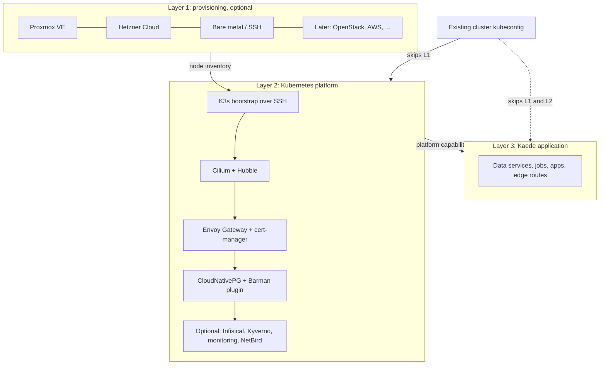
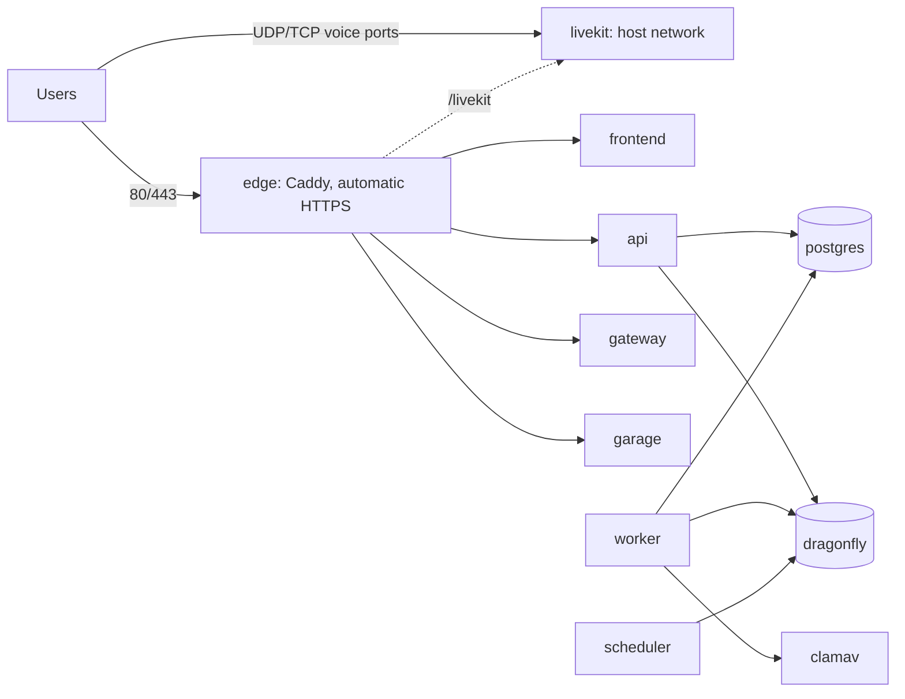
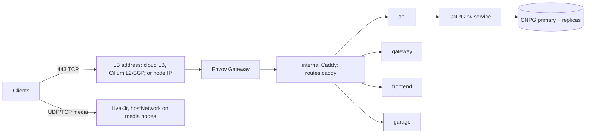
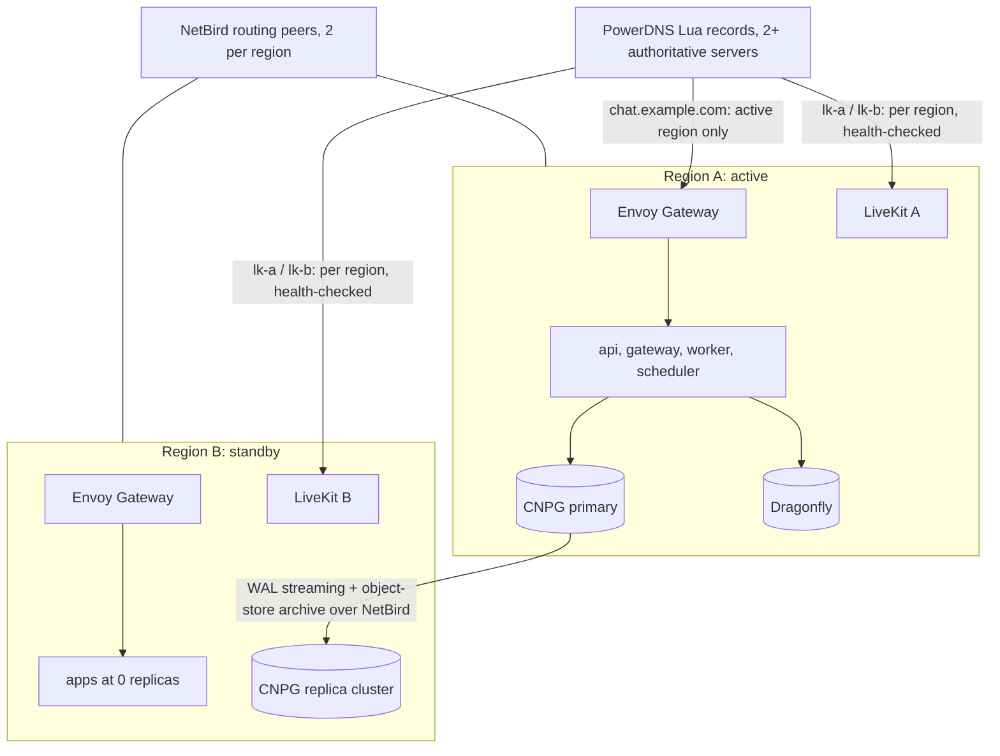

# Infrastructure modernization plan

Status: research and planning only. Nothing in this document has been
implemented, and no existing deployment, script, or workflow has changed.
Research was done on 2026-10-27. Version numbers and vendor claims reflect that
date. Items marked **(unverified)** need confirmation before anyone builds on
them.

The goal is one deployment platform with four profiles: a simple Docker
Compose install for self-hosters, a K3s and Tilt development environment,
single-region Kubernetes production, and multi-region production. All four
share images and application configuration. Infrastructure providers are
optional adapters, not dependencies.

**Recommendations at a glance**

- Keep today's Python manifest renderer as the single source of Kaede's
  Kubernetes objects. Tilt keeps consuming it directly, and Pulumi wraps the
  same output for production.
- Split the platform into three Pulumi Python layers: provisioning, Kubernetes
  platform, and application. Existing clusters skip the first layer, and
  usually the second.
- Ship the first four provider targets: existing Kubernetes, bare metal over
  SSH, Proxmox VE, and Hetzner Cloud. OpenStack (which also covers OVHcloud
  Public Cloud) and AWS come later.
- Make the frontend image instance-independent before publishing anything to
  GHCR. Today it bakes per-instance settings into the build.
- Write the new installer, `kaedectl`, in Python with Typer and line-based
  prompts. Distribute it as a PyApp single-file binary and through
  `uv tool install`. A full-screen TUI is not worth building in the first
  version.
- Use Infisical as the optional secrets backend for Standard and Global, with
  its own database and Redis-compatible store. Compose keeps a local secrets
  file by default.
- Treat Global as one writing region plus warm standby regions, with
  regional voice. PostgreSQL stays single-primary everywhere.

## 1. Current infrastructure findings

Kaede already runs production on Kubernetes. The Compose topology was removed
in commit `d837614` ("k8s conversion"), which deleted `deploy/compose.yml` and
its variants. What exists now is a small, dependency-free Python toolchain
around kubectl.

### Rendering and deployment

[deploy/kubernetes/stack.py](../deploy/kubernetes/stack.py) renders every
Kaede object as a Kubernetes `List`, which is consumed by both production and
Tilt. A few details matter for the migration:

- Third-party images are pinned by tag, not digest, at
  [stack.py:23-34](../deploy/kubernetes/stack.py#L23-L34). PostgreSQL is a
  plain `postgres:16.14-alpine` StatefulSet.
- Per-role Secrets are built from
  [environment-keys.json](../deploy/kubernetes/environment-keys.json), which is
  maintained by hand. The preflight role receives the entire `.env` regardless
  of its key list ([stack.py:179-197](../deploy/kubernetes/stack.py#L179-L197)).
- The edge Caddyfile is adapted for Kubernetes by string replacement
  ([stack.py:459-474](../deploy/kubernetes/stack.py#L459-L474)), and host
  nginx reaches the cluster through loopback `hostNetwork` bridge pods
  ([stack.py:498-543](../deploy/kubernetes/stack.py#L498-L543)).
- LiveKit runs with `hostNetwork` and TURN certificates mounted from host paths
  ([stack.py:545-607](../deploy/kubernetes/stack.py#L545-L607)).
- Every PVC uses one storage class and one size
  ([stack.py:666-678](../deploy/kubernetes/stack.py#L666-L678)).

[deploy/kubernetes/manage.py](../deploy/kubernetes/manage.py) is the release
orchestrator. It builds images locally, then either imports them into K3s
containerd through a root-owned sudo helper or pushes them to a registry
([manage.py:153-184](../deploy/kubernetes/manage.py#L153-L184)). Deployment
([manage.py:230-439](../deploy/kubernetes/manage.py#L230-L439)) contains most
of the operational knowledge worth keeping:

- It refuses to run against a cluster whose `kube-system` UID differs from the
  one recorded at setup.
- Migrations are classified by
  [migration_safety.py](../deploy/kubernetes/migration_safety.py). Anything not
  recognized as additive needs `MAINTENANCE=1`, and so does a change to
  StatefulSets, PVCs, or bridges.
- Preflight runs first, then an optional backup hook, stateful services, the
  migration Job, storage-init, and finally the applications in a fixed order
  (worker, api, gateway, scheduler, frontend).
- A failed compatible rollout restores the previous Deployment specs, and a
  `kaede-release` ConfigMap records what is deployed.

Image tags are `<revision>-<hash of all .env values>`
([manage.py:187-191](../deploy/kubernetes/manage.py#L187-L191)), so every
image is specific to one instance by construction.

### Images

The backend image ([backend/Dockerfile](../backend/Dockerfile)) is generic and
takes no build arguments. The frontend image is not. Its build stage
([frontend/Dockerfile:40-64](../frontend/Dockerfile#L40-L64)) bakes in the
media origin, upload origins, S3 addressing style, attachment bucket, landing
page variant, and six operator legal fields. The media origins end up in the
SvelteKit hash CSP through
[frontend/scripts/media-csp.mjs](../frontend/scripts/media-csp.mjs) and
[frontend/vite.config.ts](../frontend/vite.config.ts). Until that changes, a
public release image can't serve arbitrary instances.

No image is built for amd64 and arm64 together, and CI publishes nothing.
[ci.yml](../.github/workflows/ci.yml) builds development images only inside
disposable k3d clusters for acceptance checks. There's no signing, SBOM,
provenance, or image scanning; OSV scanning covers lockfiles only. The
operator guide already flags digest pinning and image scanning as missing
([docs/operator.md:1160-1166](operator.md#explicit-v1-operational-boundaries)).
Note that [desktop-release.yml](../.github/workflows/desktop-release.yml)
already triggers on `v*` tags, so a server release workflow has to coordinate
with it.

### Setup and updates

[setup.sh](../setup.sh) is a 1,700-line Bash wizard that writes `.env`,
`.kaede-kubernetes.json`, and an optional host nginx file. It's careful:
staged writes, backups under `.kaede-backups/`, `flock`, secret preservation on
rerun, and an EXIT-trap restore. Its limits are what drive the installer work:

- It requires a terminal and has no non-interactive mode
  ([setup.sh:59-62](../setup.sh#L59-L62)).
- It emits a fixed key list ([setup.sh:1328-1501](../setup.sh#L1328-L1501)),
  so a rerun drops keys it doesn't know. Today that includes the legal and
  landing settings, mobile keys, APNs relay keys, and federation peer
  overrides.
- It needs Bash 4 and GNU userland (`stat -c`, `mv -fT`, `ss`,
  `systemctl --user`), and it assumes K3s is already installed and Ready.

[deploy/auto-update.sh](../deploy/auto-update.sh) fast-forwards a clean Git
checkout and runs `manage.py deploy --update-only` from a systemd user timer.
Updates are source builds, not release pulls.

### Development and testing

[Tiltfile](../Tiltfile) drives a k3d cluster created by
[deploy/kubernetes/dev.py](../deploy/kubernetes/dev.py). The cluster is K3s
v1.36.4 in Docker, with Traefik and ServiceLB disabled, and custom
pod and service CIDRs ([dev.py:141-219](../deploy/kubernetes/dev.py#L141-L219)).
Tilt calls `dev.py build-image`, imports the image into the k3d node, and live
syncs `backend/app`, `backend/scripts`, `frontend/src`, and `frontend/static`.
The optional federation mode runs alpha and beta instances side by side.
[deploy/kubernetes/check.py](../deploy/kubernetes/check.py) reuses the same
renderer for CI acceptance clusters.

### What's missing for the target platform

There's no Pulumi, Helm, or Kustomize in the repository, and no Compose file
for the main stack. TLS lives in host nginx and Certbot, outside the cluster.
The documented topology is a single node with `local-path` volumes, and the
operator guide describes backups as a manual maintenance procedure
([docs/operator.md:562-578](operator.md#backup-and-restore-boundary)). The
architecture document still describes Compose networking (data and egress
bridges, `host.docker.internal`) in its runtime topology section, so it'll need
updating alongside this work.

Two application facts constrain any multi-region design:

- Dragonfly is not just a cache. It's the Taskiq broker (Redis Streams) and
  the authority for snowflake worker-ID leases, with a round trip on every ID
  mint ([docs/architecture.md](architecture.md#runtime-topology)).
- The instance has one federation identity. `KAEDE_SECRET_KEY` encrypts the
  signing key, and two live copies of an instance must never talk to peers.

## 2. Deployment profiles

| | Compose | Minimal | Standard | Global |
|---|---|---|---|---|
| Purpose | Single-server self-hosting | Development with hot reload | Single-region production | Multi-region production |
| Runtime | Docker Compose | K3s in k3d, driven by Tilt | Any conformant Kubernetes (K3s preferred) | One independent cluster per region |
| Images | GHCR release, by tag and digest | Built locally | GHCR release, by digest | GHCR release, by digest |
| PostgreSQL | Plain container | CloudNativePG, one instance | CloudNativePG, 1 to N instances | CloudNativePG, plus replica clusters |
| Edge | Caddy with automatic HTTPS | Caddy NodePort on loopback | Envoy Gateway, then internal Caddy | Regional Envoy Gateway, PowerDNS steering |
| Secrets | Local file, optional Infisical | Fixture credentials | Pulumi secrets or Infisical | Infisical with a standby |
| Managed by | `kaedectl` | `make dev`, Tilt | `kaedectl`, Pulumi | `kaedectl`, Pulumi |

Profile and provider are independent choices. Standard on an existing
cluster, on a Proxmox VM, and on Hetzner uses the same application layer. Only
the provisioning input differs.

### Three layers



Each layer is its own Pulumi project and stack, connected by stack outputs.
Layer 1 produces a node inventory: addresses, SSH host keys, disks, and
networks. Layer 2 turns that inventory, or an existing kubeconfig, into a
cluster and publishes a capability record. Layer 3 reads those capabilities
and never asks which provider is underneath.

On an existing cluster, layer 2 can run in "detect only" mode. It inspects
the cluster and reports which prerequisites are missing instead of installing
anything.

### Shared application configuration

The application's own settings model is the anchor:
[backend/app/core/settings.py:99](../backend/app/core/settings.py#L99) is a
Pydantic `BaseSettings` class with the `KAEDE_` prefix. The plan builds on it
rather than adding a parallel schema.

Shared between Compose and Kubernetes:

- **Release manifest.** One `release.json` per version lists every image by
  digest, Kaede's own and third-party, plus the minimum supported upgrade
  source.
- **Service catalog.** A small typed table of roles: image, command, ports,
  health endpoints, which settings each role receives, and which roles are
  writers. It replaces the commands and probes hard-coded in `stack.py` and
  becomes the generated source of `environment-keys.json`.
- **Settings.** Generated from the `Settings` model's fields, tagged by role
  and sensitivity. A CI check fails if a new setting has no role.
- **Edge routes.** A Caddy snippet with the API, gateway, media, push, and
  LiveKit routes, imported by both the Compose edge and the Kubernetes
  internal edge.

Kept separate: storage, scaling, RBAC, network policy, service discovery
names, TLS termination, and anything about nodes. The Compose file is written
by hand and stays readable. It is not generated from the catalog. A CI test
checks the two against each other: same images, same commands, same health
checks. That's cheaper than maintaining a universal generator.

## 3. Infrastructure providers

### Comparison

| Target | Pulumi Python package | Maturity | Load balancer and UDP | Storage | Fit |
|---|---|---|---|---|---|
| Existing Kubernetes | `pulumi-kubernetes` 4.34 (Pulumi) | Mature | Whatever the cluster has; detect it | Existing StorageClasses | **First release** |
| Bare metal over SSH | `pulumi-command` 1.2 (Pulumi) | Mature, low-level | Cilium LB IPAM with L2 or BGP, or MetalLB; UDP fine | Local disks, LVM, ZFS | **First release** |
| Proxmox VE | `pulumi-proxmoxve` 8.6 (community, wraps bpg 0.x) | Usable; pin both versions | None built in; same as bare metal | ZFS, LVM-thin for VM disks | **First release** |
| Hetzner Cloud | `pulumi-hcloud` 1.43 (Pulumi org) | Mature | Hetzner LB is TCP/HTTP only, so LiveKit uses node IPs | hcloud CSI volumes | **First release** |
| OpenStack | `pulumi-openstack` 5.5 (Pulumi) | Mature | Octavia; UDP support varies by cloud | Cinder CSI | Second wave |
| OVHcloud | `pulumi-ovh` 2.22 (OVH, official) | Mature | Public Cloud is OpenStack-based | Block volumes | Via OpenStack adapter |
| AWS | `pulumi-aws` 7.51, `pulumi-eks` 4.4 | Mature | NLB supports UDP | EBS CSI | Second wave |
| Google Cloud | `pulumi-gcp` 10.2 | Mature | Passthrough NLB supports UDP | PD CSI | On demand |
| Azure | `pulumi-azure-native` 3.29 | Mature | Standard LB supports UDP | Managed disks | On demand |
| DigitalOcean | `pulumi-digitalocean` 4.84 | Mature | UDP limited to 1,424-byte payloads | Volumes CSI | On demand |

Sources: [Pulumi Registry](https://www.pulumi.com/registry/),
[Hetzner LB FAQ](https://docs.hetzner.com/cloud/load-balancers/faq/),
[DigitalOcean LB limits](https://docs.digitalocean.com/products/networking/load-balancers/details/limits/),
[AWS NLB listeners](https://docs.aws.amazon.com/elasticloadbalancing/latest/network/load-balancer-listeners.html),
[bpg Proxmox provider](https://github.com/bpg/terraform-provider-proxmox).
Linode and Scaleway have maintained Pulumi providers. Vultr's community
provider hasn't released in over a year. Equinix Metal shut down on
2026-06-30 and is excluded.

### Provider notes

**Proxmox VE.** There's no Pulumi-maintained provider. The community package
bridges bpg's Terraform provider, which is still 0.x, targets PVE 9, and has
limited 8.x support. Cloned VMs with cloud-init need the `VmLegacy` resource
today; the newer cloned-VM resource doesn't manage cloud-init. Cloud-init
snippets need directory-type storage such as `local`, and uploading them
needs SSH to the node. Put VM disks on ZFS or LVM-thin and snippets on a
directory store. Proxmox has no load balancer integration, so a Proxmox
cluster gets its LoadBalancer IPs exactly like bare metal.

**Bare metal.** The adapter takes a list of hosts, users, and pinned SSH host
keys. It provisions nothing, and its output feeds the K3s bootstrap. Always set
`hostKey` on `remote.Command`; without it the host key isn't checked
([docs](https://www.pulumi.com/registry/packages/command/api-docs/remote/command/)).
Ansible's `k3s.orchestration` collection is a reasonable alternative for teams
that already use Ansible. Adding it as a second bootstrap path isn't
worthwhile.

**Hetzner Cloud.** This is the cheapest mature cloud API in the first set, but
two things need care. Its load balancer has no UDP, so LiveKit media goes
straight to node Primary IPs. And prices rose on 2026-06-15 for new orders
(CPX22 went from €7.99 to €19.49 a month), with the cheap CX and CAX lines
available only in Germany and Finland and sometimes sold out
([price adjustment](https://docs.hetzner.com/general/infrastructure-and-availability/price-adjustment/)).
Hetzner dedicated servers (Robot) have no Pulumi provider. Users can run the
bare metal adapter on them instead.

**Existing Kubernetes.** This is a first-class target, not a fallback. The
adapter takes a kubeconfig and context, verifies the cluster UID as
`manage.py` does today, and detects:

- the default StorageClass and whether it supports expansion and snapshots;
- whether a LoadBalancer Service gets an address (a short-lived probe
  Service);
- Gateway API CRDs and their bundle version, plus existing GatewayClasses;
- the CNI, whether kube-proxy is present, and whether NetworkPolicy is
  enforced;
- dual-stack support, and whether the distribution is K3s, which decides
  whether the embedded registry mirror is available.

Missing prerequisites produce a clear report. The application layer doesn't
silently degrade.

### Recommended initial set

Existing Kubernetes, bare metal, Proxmox, and Hetzner cover the people most
likely to self-host Kaede: homelab and Proxmox users, VPS users, and teams
with a cluster already. Bare metal comes almost free, because every VM-based
adapter hands its machines to the same SSH bootstrap. OpenStack comes next,
since one adapter also covers OVHcloud Public Cloud and many regional clouds.
AWS follows for users who need it. Its egress pricing ($0.09/GB after the
first 100 GB, per the [EC2 pricing page](https://aws.amazon.com/ec2/pricing/on-demand/))
makes it a poor default for media-heavy chat.

### Token handling

K3s join tokens should never sit in cloud-init user data. User data stays on
disk after boot and can often be read back through the provider API or
metadata service
([AWS](https://docs.aws.amazon.com/AWSEC2/latest/UserGuide/user-data.html)),
and Proxmox snippets are plaintext on the host. The bootstrap should work like
this:

- Generate the server and agent tokens with `pulumi_random`, stored as Pulumi
  secrets.
- Push them over SSH with a pinned host key into `0600` files referenced by
  `token-file`.
- Use the secure `K10<CA hash>::` token format, with a separate
  `agent-token`.
- Prefer short-lived bootstrap tokens (`k3s token create`) for nodes added
  later ([K3s token docs](https://docs.k3s.io/cli/token)).

## 4. Provider-independent Pulumi Python design

### Capability contract

Providers declare what they can do through typed models. The platform and
application layers consume those models and nothing else. A rough shape, with
Pydantic v2 (already a backend dependency):

```python
class StorageOffer(BaseModel):
    storage_class: str
    node_local: bool            # local-path, TopoLVM, OpenEBS LVM/ZFS
    enforces_capacity: bool     # local-path does not
    expandable: bool
    snapshots: bool             # CSI VolumeSnapshot support

class LoadBalancerOffer(BaseModel):
    kind: Literal["cloud", "cilium-l2", "cilium-bgp", "metallb", "node-ip", "none"]
    udp: bool                   # False on Hetzner LB, partial on DigitalOcean
    ipv6: bool
    preserves_client_ip: bool

class Node(BaseModel):
    name: str
    address: IPvAnyAddress
    ssh_host_key: str
    roles: set[Literal["server", "agent", "media"]]
    zone: str | None

class ProvisionedRegion(BaseModel):
    region: str
    nodes: list[Node] | None    # None when the provider returns a cluster
    kubeconfig: SecretStr | None
    pod_cidr: IPv4Network
    service_cidr: IPv4Network
    load_balancer: LoadBalancerOffer
    storage: list[StorageOffer]
    limitations: list[str]      # shown to the operator, never hidden

class Provisioner(Protocol):
    name: ClassVar[str]
    def validate(self, spec: RegionSpec) -> list[Problem]: ...
    def provision(self, spec: RegionSpec) -> ProvisionedRegion: ...  # runs inside a Pulumi program
```

The `limitations` field matters. A Hetzner region reports "UDP load
balancing unavailable; LiveKit uses node addresses". A single-node region
reports "no PostgreSQL failover". `kaedectl` prints these before deploying,
and the application layer refuses settings that contradict them. For example,
it won't accept three database instances with node-local storage on a
one-node cluster.

### Components

All Pulumi code lives in one Python package, `kaede_deploy`, with
`ComponentResource` classes:

- **Provisioning (layer 1):** `ProxmoxRegion`, `HetznerRegion`,
  `BareMetalRegion`. Each returns a `ProvisionedRegion`.
- **Platform (layer 2):**
  - `K3sCluster` bootstraps servers and agents over SSH from a node list and
    writes `/etc/rancher/k3s/config.yaml`. The flags are
    `flannel-backend: none`, `disable-network-policy`, `disable-kube-proxy`,
    `disable: [traefik, servicelb]`, `embedded-registry: true`, and
    `secrets-encryption: true`. They're set at first boot, because disabling
    Traefik later removed the Gateway API CRDs on K3s releases before April
    2026 ([K3s networking](https://docs.k3s.io/networking/networking-services)).
  - `Cilium` with Hubble, LB IPAM pools, and L2 or BGP announcements.
  - `EnvoyGateway`, `CertManager`, `CloudNativePG` (operator plus Barman
    Cloud plugin), and the optional services below.
- **Application (layer 3):** `KaedeInstance`. It takes the instance
  configuration, a release manifest, and the platform capability record.

`KaedeInstance` doesn't build Kubernetes objects itself. It calls the same
renderer that Tilt uses, which today is `stack.render()` and will be the
refactored `kaede_deploy.render` package. It then wraps the result in
`pulumi_kubernetes.yaml.v2.ConfigGroup` groups, so dependencies can be
expressed between them: data services, then jobs, then applications. That
keeps one definition of every Kaede object and lets `deploy/tests` keep
checking manifests with plain dictionaries. Third-party operators and charts
are installed with `helm.v4.Chart`. Pulumi's docs disagree on whether `Chart`
or `helm.v3.Release` is the production choice
([tutorial](https://www.pulumi.com/dev/tutorials/choosing-the-right-helm-resource/)
versus the [Chart page](https://www.pulumi.com/registry/packages/kubernetes/api-docs/helm/v4/chart/)).
Use `Chart` unless a chart depends on Helm hooks **(unverified per chart)**.

### Release orchestration stays outside Pulumi

Pulumi is declarative. Kaede's rollout isn't: maintenance mode scales writers
to zero before migrating, migrations are classified before anything changes,
and failed rollouts restore the previous specs. That logic stays in the
management layer, which drives Pulumi through the Automation API in steps:

1. Run the migration safety check and preflight against the target release.
2. Run `stack.preview()` and inspect the diff. A replacement of a CNPG
   `Cluster`, PVC, or StatefulSet stops the run unless maintenance was
   requested. Today's infrastructure digest does the same job; the preview is
   more precise.
3. Call the backup hook. In maintenance mode, run `up` with writer replicas
   set to zero, then run `up` with the new release.
4. Inside that `up`, the migration Job's name includes the schema digest.
   Deployments depend on it and on each other in today's order, and Pulumi
   waits for each rollout.
5. If the rollout fails, run `up` again with the previous release manifest,
   which is kept as a stack output.

### State, secrets, and workflows

- **State backend.** Use an S3-compatible DIY backend
  (`s3://bucket?endpoint=...&s3ForcePathStyle=true`) or `file://` on the
  management host for single-admin installs
  ([backends](https://www.pulumi.com/docs/iac/concepts/state-and-backends/)).
  Never keep the state in the object store of the cluster it describes. DIY
  locking isn't transactional, so `kaedectl` keeps its own `flock`, as
  `manage.py` does now. Pulumi Cloud remains an option, never a requirement.
- **Secrets provider.** Default to `passphrase`, with the passphrase in a
  `0600` file and an offline copy. Offer `hashivault://` (works with OpenBao)
  or a cloud KMS for teams that have one. Pulumi ESC depends on Pulumi Cloud,
  so it stays optional.
- **Preview, deploy, rollback.** `kaedectl plan` is `preview`.
  `kaedectl deploy` is the orchestration above. `kaedectl rollback` redeploys
  the previous manifest; it never downgrades the schema. Recovery after a
  crash uses `pulumi refresh`, then `pulumi cancel` if a lock is stale.
- **Runtime.** Projects use `runtime: {name: python, options: {toolchain: uv}}`
  and `typechecker: mypy`
  ([Python docs](https://www.pulumi.com/docs/iac/languages-sdks/python/)).
  `kaedectl` pins the CLI version with `PulumiCommand.install(version=...)`.

### Automation API and the Kubernetes Operator

The Python Automation API is stable and first-class. `kaedectl` uses
`LocalWorkspace` on the Pulumi projects shipped inside its package, not inline
programs. That way an operator can still `cd` into a project and run
`pulumi preview` by hand. Engine events stream into `kaedectl` output so that
progress and errors read in plain language.

The Pulumi Kubernetes Operator v2 can reconcile stacks from Git inside the
cluster. Its examples assume Pulumi Cloud, and it would put cloud and cluster
credentials inside the cluster it manages. Leave it out of the first releases
and revisit it for operators who want GitOps.

### Testing and linting

- Unit test components with `pulumi.runtime.set_mocks` under pytest. Pulumi
  documents unittest; pytest works through `@pulumi.runtime.test`
  **(unverified on current SDK)**.
- Keep and extend golden manifest tests in
  [deploy/tests/test_kubernetes.py](../deploy/tests/test_kubernetes.py)
  against the renderer.
- Add a CI integration job that runs layers 2 and 3 against a k3d cluster,
  using the existing-cluster target. A nightly Hetzner job is optional; it
  costs real money.
- Use Ruff for linting and formatting and mypy in strict mode, matching the
  backend's tooling. CrossGuard policy packs can run locally with
  `pulumi preview --policy-pack` on any backend.

### Optional platform services

| Service | Compose | Minimal | Standard | Global | Notes |
|---|---|---|---|---|---|
| cert-manager | No (Caddy does ACME) | No | Required | Required | The Barman Cloud plugin needs it |
| CloudNativePG + Barman plugin | No | Yes | Yes | Yes | In-tree Barman is removed in CNPG 1.31 |
| Infisical | Optional, external | No | Optional | Recommended | See below |
| External Secrets Operator | No | No | Optional | Optional | Only if using a non-Infisical store |
| Kyverno | No | No | Recommended | Recommended | Image signature checks |
| Prometheus, Grafana, Loki | Optional profile | No | Optional | Recommended | Keep today's bundled dashboards |
| Tempo, OpenTelemetry | No | No | Optional | Optional | Needs backend instrumentation first |
| Proxmox Backup Server | Host-level | No | If on Proxmox | If on Proxmox | VM-level, not database-consistent |
| K3s etcd snapshots | No | No | Yes | Yes | Off-cluster S3 target |

**Infisical.** Self-hosted Infisical has no identity or user limits, and
single-region HA is free: several stateless replicas, PostgreSQL through
CloudNativePG, and Redis through Sentinel. Infisical's own
[Kubernetes HA reference](https://infisical.com/docs/self-hosting/reference-architectures/on-prem-k8s-ha)
uses CloudNativePG. Several features need an enterprise license:

- active multi-region replicas ([replication guide](https://infisical.com/docs/self-hosting/guides/replication));
- audit logs, point-in-time recovery, custom roles, and SSO or LDAP for
  people;
- approvals, rotation, dynamic secrets, and IP allowlisting;
- HSM or external KMS protection of the root key;
- the operator's instant updates.

The design that follows from this:

- **Placement.** Infisical runs in its own namespace with its own
  CloudNativePG cluster and its own Redis or Valkey. It doesn't use Kaede's
  Dragonfly. Infisical's queue (BullMQ) only uses the key prefixes Dragonfly
  needs in cluster mode, so Dragonfly would need a global-lock Lua flag, and
  the combination is untested.
- **Delivery to Kaede.** The Infisical operator syncs into Kaede's per-role
  Secrets, one `InfisicalStaticSecret` per role. Whether it can select a
  subset of keys per role through templates is **(unverified)**. If it can't,
  keep one folder per role in Infisical.
- **Outages.** On a failed sync the operator keeps the Secrets it last wrote
  (read from source, not documented), so Kaede keeps running and can restart
  while Infisical is down.
- **Root keys.** `ENCRYPTION_KEY` and `AUTH_SECRET` can't live in Infisical
  itself. Pulumi generates them, keeps them as stack secrets, and `kaedectl`
  exports an offline copy. Without `ENCRYPTION_KEY`, a database restore can't
  be decrypted.
- **Global.** One primary Infisical plus a standby promoted with the CNPG
  replica cluster. That's active-passive and free.
- **Compose.** Infisical wants 4 to 8 GB of RAM, so on a small server it
  would roughly double the footprint. Compose keeps a local secrets file.
  `kaedectl secrets pull` can fetch from an external Infisical when an
  operator has one.

If audit logs turn into a hard requirement before a license is affordable,
OpenBao (MPL-2.0, free Raft HA) is the fallback. It costs more to operate.

## 5. Proposed repository structure

```text
deploy/
  kaede_deploy/                 # one Python package, uv-managed (pyproject.toml, uv.lock)
    config/                     # Pydantic models: instance, profiles, providers, release manifest
    catalog.py                  # service catalog (roles, commands, ports, probes, writer flag)
    render/                     # Kubernetes object renderer (refactored stack.py)
    release/                    # migration safety, preflight, ordered rollout, rollback
    compose/                    # Compose backend: upgrade, backup, restore, doctor
    providers/                  # existing, baremetal, proxmox, hetzner (later: openstack, aws)
    platform/                   # K3s, Cilium, Envoy Gateway, cert-manager, CNPG, optional services
    app/                        # KaedeInstance component
    cli/                        # kaedectl (Typer)
  pulumi/
    provision/Pulumi.yaml       # layer 1 program: selects a provider adapter
    platform/Pulumi.yaml        # layer 2 program
    kaede/Pulumi.yaml           # layer 3 program
  compose/
    compose.yaml                # hand-written, images pinned by the release manifest
    caddy/                      # Compose edge site blocks
  caddy/
    routes.caddy                # shared application routes (Compose and Kubernetes)
    internal.caddy              # Kubernetes internal edge (auto_https off, edge secret)
  kubernetes/                   # kept as thin shims during migration (dev.py, check.py, manage.py)
  tests/                        # existing tests, plus Pulumi mocks and Compose parity tests
.github/workflows/
  server-release.yml            # build, sign, attest, scan, publish, release manifest
```

The current `deploy/kubernetes/*.py` files stay where they are until their
logic has moved, so `make dev`, `make check`, and production deploys keep
working throughout. The Tiltfile keeps calling `deploy/kubernetes/dev.py`,
which imports the new renderer. One `pyproject.toml` for `deploy/` replaces the
current "standard library only" constraint. That's a real change: the scripts
currently run on any `python3`. `kaedectl` and Tilt would run them through uv
instead.

## 6. Docker Compose implementation strategy

Compose comes back as a first-class profile for people who want Kaede on one
server without learning Kubernetes. The previous Compose topology is a useful
reference (`git show d837614^:deploy/compose.yml`). The new one has three
differences: it pulls release images instead of building, it terminates TLS
itself, and `kaedectl` manages it.

### Topology



- **Services.** `edge`, `frontend`, `api`, `gateway`, `worker`, `scheduler`,
  `postgres`, `dragonfly`, and `clamav` always run. Garage, Meilisearch,
  LiveKit, and observability are Compose profiles, enabled from
  configuration. `preflight`, `migrate`, and `storage-init` are one-shot
  services that `kaedectl` runs with `docker compose run --rm`.
- **Networks.** A `data` network marked `internal: true` holds PostgreSQL,
  Dragonfly, Garage, ClamAV, and Meilisearch. Only roles that need outbound
  federation, email, or push traffic join an `egress` network. The
  architecture document describes this layout already.
- **Edge.** Caddy owns ports 80 and 443 and gets certificates through ACME. It
  imports the shared `routes.caddy` and keeps the same security headers.
  There's no host nginx or Certbot to install. Operators who already run nginx
  can bind the edge to loopback and keep their proxy, as today.
- **LiveKit.** It keeps `network_mode: host` and the five configurable ports.
  TURN/TLS reads its certificate from Caddy's data volume, mounted read-only.
  Caddy's renewal doesn't restart LiveKit, so `kaedectl` installs a small
  renewal check that does **(approach to validate)**.
- **Per-role environment.** `kaedectl` writes `env/<role>.env` files from the
  service catalog, so Compose keeps the same secret split as Kubernetes. The
  gateway never sees `KAEDE_SECRET_KEY`, and the scheduler gets only the
  broker URL.
- **Images.** Pinned as `ghcr.io/<org>/kaede-backend:v1.4.2@sha256:...` from
  the release manifest. Compose accepts tag-plus-digest references, which
  keeps the file readable and the pull exact.

PostgreSQL in Compose is the official image, not CloudNativePG. Moving to the
Debian-based image used by CloudNativePG avoids a collation difference later
(see section 10).

### Lifecycle

- **Install.** `kaedectl init` asks for the domain, email provider, storage
  choice, and optional features. It checks DNS and that ports 80 and 443 are
  free, writes `kaede.yaml` and `secrets.env`, pulls images, runs preflight,
  migrates, and starts the stack. It finishes by printing the owner-account
  command.
- **Configure.** `kaedectl config set` and `kaedectl config edit` validate the
  same Pydantic models before writing. `kaedectl apply` recreates only the
  containers whose configuration changed.
- **Update.**
  1. `kaedectl upgrade` downloads the next release manifest, verifies its
     signature, and checks that the current version is a supported starting
     point.
  2. It pulls images, then runs preflight and the migration plan from the new
     backend image. That requires moving migration classification out of
     `deploy/kubernetes/migration_safety.py` and into the backend image as a
     `kaede migration-plan` command.
  3. For additive migrations, it takes a backup, migrates, and recreates
     containers in the current rollout order.
  4. Anything else requires `--maintenance`, which stops writers first.
- **Backup.** The backup format is the same for every profile:
  - a custom-format `pg_dump`;
  - a Dragonfly snapshot;
  - an S3-API copy of the three buckets (works for Garage and external S3,
    and avoids the stop-the-world Garage metadata copy);
  - `kaede.yaml`, the secrets file, and a checksum manifest.

  Archives are encrypted with age. They go to a local directory and, ideally,
  an off-host S3 target or restic repository. `kaedectl backup schedule`
  installs a timer.
- **Restore.** `kaedectl restore` only targets an empty install, checks that
  the domain and `KAEDE_SECRET_KEY` match, and refuses to start writers until
  the import finishes. The same archive restores into Standard, which becomes
  the supported way to move from Compose to Kubernetes.
- **Troubleshooting.** `kaedectl doctor` checks:
  - DNS records against the host's public address;
  - port 80 and 443 reachability and certificate expiry;
  - container health, disk space, and clock skew;
  - database migrations at head;
  - LiveKit's TCP ports.

  It prints a suggested fix for each failure. `kaedectl logs <role>` and
  `kaedectl support-bundle` collect logs with credentials redacted.

Expected downtime for a compatible Compose upgrade is a few seconds per
single-replica service, plus WebSocket reconnects. Maintenance upgrades stop
writers for the length of the migration.

The existing `legacy.py` export path keeps working for Compose installs that
predate the Kubernetes conversion. New Compose installs use the
profile-independent backup format instead of volume archives.

## 7. Tilt compatibility strategy

The development loop is the part most likely to break by accident, so the
rule is that every refactor phase ends with `make dev`, `make dev-federation`,
and the acceptance checks still working unchanged.

What stays:

- k3d with one server node, per-checkout cluster names, loopback-only ports,
  and the separate dev CIDRs. Flannel remains the default CNI in dev.
- `custom_build` with `skips_local_docker` and image import, and `live_update`
  syncs for the backend and frontend. The `fall_back_on` lists and the
  hot-reload commands (`uvicorn --reload`, Taskiq `--reload`, `watchfiles`)
  are unchanged.
- `make dev-down` stopping rather than deleting the cluster, and the federation
  alpha and beta instances.

What changes:

- **Renderer entry point.** Once the renderer needs Pydantic, the Tiltfile
  calls `uv run --project deploy deploy/kubernetes/dev.py ...` instead of
  `python3`. `make tools` installs a pinned uv alongside kubectl, k3d, and
  Tilt.
- **PostgreSQL through CloudNativePG.** The dev cluster runs the CNPG operator
  and a one-instance `Cluster` with `enablePDB: false`, so development
  exercises the same database objects as production. `dev.py cluster`
  installs the operator once. Tilt groups the CNPG pods with
  `k8s_kind('Cluster', pod_readiness='wait')`, and the `migrate-<ns>` resource
  depends on that group instead of `postgres-<ns>`. Existing dev clusters keep
  their data through `kaedectl dev migrate-db`, which runs a dump and import.
  The plain StatefulSet stays available behind a flag for one release.
- **Optional platform parity.** `make dev CNI=cilium` creates a k3d node with
  `flannel-backend: none`, the bpffs mount, and Cilium. `make dev EDGE=envoy`
  puts Envoy Gateway in front of the internal Caddy. Neither is the default,
  because both slow cluster creation and neither affects application hot
  reload. Cilium on k3d needs extra node mounts **(unverified on k3d 5.8)**.
- **CI check.** Add a CI job that runs `tilt ci` against a fresh k3d cluster,
  so Tiltfile breakage is caught before it reaches a developer.

Development never needs GHCR, Pulumi, Infisical, or monitoring. Release
images can still be tested locally with `kaedectl` against the dev cluster as
an existing-cluster target.

## 8. GHCR and Spegel migration

### Prerequisite: instance-independent images

Generic release images need application changes first:

1. **Runtime public configuration.** The landing variant, legal fields, media
   origin, upload origins, bucket, and addressing style move out of build
   arguments. The SPA reads them at startup from a public configuration
   endpoint. The backend already serves public configuration routes (for
   example [backend/app/api/auth.py:291](../backend/app/api/auth.py#L291)).
   Alternatively, a static `config.json` is written by the frontend
   container's entrypoint. The API endpoint is simpler, since
   `deploy/validate_deploy_env.py` already has validation rules to reuse. It
   does mean adding the landing and legal fields to the backend `Settings`
   model; today only `KAEDE_LEGAL_CONTACT_EMAIL` reaches the API.
2. **CSP split.** The SvelteKit meta CSP keeps the script hashes and drops
   `connect-src` media origins. The edge sends `connect-src` as a header built
   from runtime settings. Browsers enforce every policy present, so the meta
   policy must not also restrict `connect-src`. `verify-csp.mjs` and
   `media-csp.mjs` need rewriting to check the combined result.
3. **Tags.** Image tags become the release version. The configuration hash in
   [manage.py:187-191](../deploy/kubernetes/manage.py#L187-L191) goes away,
   and configuration changes roll pods through Secret and ConfigMap name
   digests, as the renderer already does.

The custom landing page's legal text would then render client-side. If search
engines need to see it, the frontend container can template the HTML at start
instead **(decision needed)**.

### Publishing

A new `server-release.yml` runs on version tags. It shares the `v*` tag with
the desktop release workflow, or uses a `server-v*` prefix **(decision
needed)**. The workflow:

- builds `kaede-backend` and `kaede-frontend` for `linux/amd64` and
  `linux/arm64` with Buildx. Backend arm64 dependencies (ffmpeg, libvips, and
  the rembg/ONNX runtime wheels) need checking **(unverified)**;
- attaches BuildKit SBOM and provenance (`--sbom=true --provenance=mode=max`)
  and GitHub attestations through `actions/attest@v4`
  ([repo](https://github.com/actions/attest));
- signs each digest with keyless cosign using the workflow's OIDC identity.
  Cosign v3 writes the new bundle format by default
  ([announcement](https://blog.sigstore.dev/cosign-3-0-available/));
- scans images with `osv-scanner scan image`, which keeps one scanner in the
  repository, and fails on unignored high-severity findings;
- mirrors pinned third-party images (PostgreSQL, Dragonfly, Garage, ClamAV,
  Meilisearch, Caddy, LiveKit, monitoring) into `ghcr.io/<org>/mirror/*` by
  digest. That removes Docker Hub rate limits from installs and keeps old
  releases installable;
- publishes a signed `release.json` with every digest, and the `kaedectl`
  binaries.

Images should be public. Kaede is open source, anonymous GHCR pulls need no
credentials, and storage and bandwidth for public packages are currently free
([GitHub Packages billing](https://docs.github.com/en/billing/concepts/product-billing/github-packages)).
Forks with private images should know that GHCR accepts only classic personal
access tokens. Fine-grained tokens don't work, so "least privilege" means a
dedicated machine account with only `read:packages`
([GHCR docs](https://docs.github.com/en/packages/working-with-a-github-packages-registry/working-with-the-container-registry)).

Retention: keep every release digest forever and delete untagged development
builds after 30 days with `actions/delete-package-versions`. Deleting untagged
versions can remove per-platform manifests and attestations that release
indexes point to **(test before enabling)**.

In-cluster verification uses Kyverno `ImageValidatingPolicy`. The older
`verifyImages` rule is deprecated in 1.19 and removed in 1.20
([Kyverno 1.19](https://kyverno.io/blog/2026/08/20/announcing-kyverno-release-1.19/)).
A CI test checks the exact cosign output against the exact Kyverno version,
since bundle-format compatibility has had reported problems **(unverified
report)**. Start in audit mode.

### Image distribution on clusters

- **K3s:** enable the embedded registry mirror (`embedded-registry: true`)
  with `registries.yaml` mirror entries for `ghcr.io` and `docker.io` on every
  node. It's GA since v1.29.12, v1.30.8, and v1.31.4. Peers talk over TCP 5001
  and 6443 inside the cluster only, so distribution is cluster-scoped by
  design ([K3s registry mirror](https://docs.k3s.io/installation/registry-mirror)).
  Deploy by digest. `latest` isn't shared, and digests can't be poisoned by a
  compromised node. Private images are served to peers without upstream
  credentials, which is one more reason to prefer public images.
- **Other distributions:** standalone Spegel works on containerd with
  `config_path` and `discard_unpacked_layers=false`. AKS works directly; EKS
  and GKE need node configuration ([Spegel docs](https://spegel.dev/docs/getting-started/)).
  Where that isn't possible, a Zot or Harbor pull-through cache per region
  serves cached images during a GHCR outage. Managed clusters close to a cloud
  registry may need neither.
- **Compose:** images stay in the local Docker store. `kaedectl images export`
  writes an offline bundle for air-gapped installs.

## 9. Networking and multi-region design

### Single region (Standard)



- **Cilium.** Cilium 1.20 replaces kube-proxy, with Hubble relay enabled and
  the UI optional. K3s starts with flannel, kube-proxy, network policy,
  Traefik, and ServiceLB disabled
  ([Cilium on K3s](https://docs.cilium.io/en/stable/installation/k3s/)).
  LoadBalancer addresses come from the cloud LB where one exists. Otherwise
  Cilium LB IPAM provides them, announced by L2 for small sites or BGP where
  there's a router to peer with.
- **Envoy Gateway.** Use Envoy Gateway 1.9, which needs the Gateway API v1.6
  CRDs. It owns public TLS through cert-manager's Gateway support and replaces
  host nginx and Certbot. Leave Cilium's own Gateway API implementation
  disabled (the default) and install the CRDs once
  ([Cilium Gateway API](https://docs.cilium.io/en/stable/network/servicemesh/gateway-api/gateway-api/)).
  Running both implementations side by side isn't covered by either project's
  docs.
- **Client addresses.** Envoy Gateway's Service defaults to
  `externalTrafficPolicy: Local`, which Cilium L2 announcements don't support.
  With L2, set `Cluster` in the `EnvoyProxy` resource. On one node that
  preserves client addresses anyway. On several nodes, use Cilium DSR, BGP
  with `Local`, or PROXY protocol from a cloud LB **(DSR behavior to verify)**.
  Kaede's rate limits depend on correct `X-Forwarded-For`.
- **Internal Caddy.** It keeps every application route and its security
  headers, now loaded from `routes.caddy` instead of string-patched. Porting
  the media `forward_auth` gate and header sanitization to Envoy
  `SecurityPolicy` would be a large, risky rewrite with no user benefit. A
  Cilium NetworkPolicy lets only Envoy pods reach Caddy. The edge secret stays
  for defense in depth, though its value would live in an `HTTPRoute`
  header filter rather than a Secret **(decision needed)**.
- **Limits from nginx.** Per-address limits on `/gateway` upgrades and
  `/_kaede/v1/link` move to Envoy local rate limiting, which needs no Redis.
  Global rate limiting would need Redis, and Dragonfly as its backend is
  untested.
- **WebSockets.** Envoy Gateway enables upgrades on every HTTPRoute by default.
  Set explicit idle and stream timeouts above the gateway heartbeat interval,
  since the defaults weren't checked **(unverified)**. The existing 30-second
  gateway `preStop` and client resume logic cover rollouts.
- **LiveKit.** Media stays off Envoy, whose UDPRoute proxying hides the client
  address. LiveKit keeps `hostNetwork` on nodes labelled for media, with the
  node's own public address, as in the
  [LiveKit Kubernetes guide](https://docs.livekit.io/home/self-hosting/kubernetes/).
  The TURN certificate becomes a cert-manager `Certificate` mounted from a
  Secret, replacing host paths, and a renewal triggers a restart. Several
  LiveKit nodes in one region need a shared Redis, and a room must fit on one
  node ([distributed setup](https://docs.livekit.io/transport/self-hosting/distributed.md)).
  Whether Dragonfly works as LiveKit's Redis is **(unverified)**.
- **IPv6.** Dual-stack must be chosen at cluster creation, with dual CIDRs on
  every server and `ipv6.enabled` in Cilium. Offer it per region, off by
  default, and only publish AAAA records when the edge actually answers on
  IPv6.

### Address plan

| Item | Region *n* (1 to 9) | Dev (k3d) |
|---|---|---|
| Pod CIDR (IPv4) | `10.10n.0.0/16` (10.101, 10.102, ...) | `10.52.0.0/16` |
| Service CIDR | `10.20n.0.0/16` | `10.53.0.0/16` |
| Inter-region LB pool | `10.10n.255.0/24` carved from a node-routable range | n/a |
| IPv6 (optional) | One random ULA /48 per installation, /56 per region | n/a |
| Cilium cluster ID | *n* | n/a |

Distinct ranges cost nothing now and keep Cluster Mesh and NetBird routing
possible later.

### Global

Kaede's write path doesn't partition by region. PostgreSQL is single-primary,
Dragonfly holds worker-ID leases and the task queue, and federation needs
exactly one live identity. Global therefore means **one active region plus
warm standbys**, with regional voice as the main latency win:



- **Application hostname.** `chat.example.com` answers with the active
  region's ingress addresses, health-checked with `ifurlup` against
  `/health/ready`. Which region is active is set by `kaedectl region promote`
  through the PowerDNS API, never by health checks alone. If DNS picked the
  standby automatically, it would send users to a region whose writers are
  off, or worse, create two writers after a partition.
- **Voice.** Each region runs its own LiveKit with its own Redis. Self-hosted
  LiveKit regions don't relay media to each other; that's a LiveKit Cloud
  feature, according to a community answer **(unverified)**. Kaede's API
  would pick a region per room and hand clients that region's URL. Today
  there's one `KAEDE_VOICE_PUBLIC_URL`, so this is an application change.
  Per-region `lk-<region>` names use `ifportup` health checks.
- **Inter-region links.** The links that need them are CNPG streaming,
  Garage RPC if Garage spans regions, Infisical's standby database, LiveKit
  webhooks to the active API, and metrics. These use NetBird Networks with
  two routing peers per region (metric-ordered failover), advertising each
  region's inter-region LB pool. Pods don't join NetBird.
  - Masquerading means traffic arrives from the routing peer's address, so
    CNPG replication authenticates with TLS client certificates rather than
    source addresses.
  - Routing peers clamp TCP MSS, because WireGuard's 1,280-byte default MTU
    is smaller than pod and node MTUs
    ([NetBird site-to-site](https://docs.netbird.io/manage/networks/use-cases/site-to-site)).
- **NetBird itself.** NetBird's client is BSD-3, while the management, signal,
  and relay servers are AGPLv3, and active-active HA for them is
  enterprise-licensed. A single self-hosted management server is acceptable:
  existing tunnels keep working while it's down, though peers can't change
  **(behavior during management outage unverified)**. NetBird's hosted service
  is an alternative.
- **PowerDNS.** Run PowerDNS Authoritative 5.1 with `enable-lua-records`, the
  GeoIP backend with an MMDB database (DB-IP Lite or MaxMind GeoLite2), and
  `edns-subnet-processing=yes`
  ([Lua records](https://doc.powerdns.com/authoritative/lua-records/index.html)).
  - Records use 30 to 60 second TTLs.
  - DNSSEC must use live signing, because pre-signed zones can't use Lua
    records.
  - Each authoritative server runs its own health checks, so servers can
    disagree for a few seconds after a change.
  - Many resolvers don't send client subnets, so `pickclosest` often
    geolocates the resolver rather than the user.
- **Cluster Mesh.** Not part of this design. If it's enabled later, every node
  needs direct reachability on its InternalIP, which NetBird's masquerading
  breaks unless each node is a peer **(unverified)**.

Failover behavior:

- **WebSockets.** Long-lived connections to a dead region usually see no FIN.
  Clients find out through heartbeats, then reconnect with backoff and
  resume.
- **DNS.** Health-check detection, the record TTL, and resolver and browser
  caching add up to about one to two minutes for DNS-steered names.
- **Writers.** Promoting a standby region adds the manual promotion time in
  section 10. Voice calls in a failed region rebuild in another region when
  clients rejoin.

Regional failure isolation: a standby region keeps serving voice for rooms
it hosts, and its loss doesn't affect the active region. A NetBird partition
pauses replication and lets lag grow. It doesn't trigger promotion.

## 10. CloudNativePG and storage design

### Database clusters

Target CloudNativePG 1.30 on PostgreSQL 16 at first, matching today's major
version. Major upgrades come later through CNPG's offline in-place upgrade
([upgrades](https://cloudnative-pg.io/docs/1.30/postgres_upgrades/)).

| Profile | Instances | Replication | Backups |
|---|---|---|---|
| Minimal | 1, `enablePDB: false` | None | None |
| Standard, one node | 1 | None | Barman Cloud plugin to off-host S3, WAL archive, PITR |
| Standard, 3+ nodes | 3, spread across nodes | `synchronous: {method: any, number: 1}` | Same, plus volume snapshots if the CSI driver supports them |
| Global | 3 in the active region, 1 to 3 in each standby | Replica clusters via `spec.replica` distributed topology | Each region archives to its own bucket |

- **Backups.** Use the Barman Cloud plugin from day one. In-tree
  `barmanObjectStore` is deprecated and now scheduled for removal in 1.31
  ([release notes](https://github.com/cloudnative-pg/cloudnative-pg/blob/main/docs/src/release_notes/v1.30.md)).
  The plugin needs cert-manager. Backups must go to a different failure domain
  than the database. On a single node, that rules out the bundled Garage.
- **Synchronous replication.** With three instances, `dataDurability:
  required` gives zero data loss and tolerates losing one standby
  ([replication](https://cloudnative-pg.io/docs/1.30/replication/)). Two
  instances should use `preferred` or stay asynchronous. Otherwise one
  failure blocks writes.
- **Pooling.** Connect migrations directly to the `-rw` Service. A PgBouncer
  `Pooler` is optional and should start in session mode. The backend uses
  asyncpg, whose prepared statements need PgBouncer's prepared-statement
  support or a disabled statement cache in transaction mode. Alembic and
  partition maintenance take advisory locks
  ([partitions.py:58](../backend/app/db/partitions.py#L58)).
- **Failover inside a region.** This is automatic. CNPG 1.30 adds a
  Lease-based promotion gate, and the primary isolation check restarts a
  primary that can reach neither the API server nor its peers
  ([failover](https://cloudnative-pg.io/docs/1.30/failover/)). Set
  `smartShutdownTimeout` low, so an isolated primary stops accepting commits
  quickly.

### Cross-region promotion

CNPG never promotes across Kubernetes clusters on its own. `kaedectl region`
wraps the documented procedure
([replica clusters](https://cloudnative-pg.io/docs/1.30/replica_cluster/)).

**Planned switchover**, with no data loss:

1. Put the active region in maintenance. Scale writers to zero and block
   federation egress.
2. Set `spec.replica.primary` on the current primary to the target region and
   wait for `.status.demotionToken`.
3. On the target, set `primary` to itself and `promotionToken` to the token in
   one change.
4. Point the application record at the target, start writers there, and leave
   maintenance.

**Disaster promotion**, when the active region is unreachable:

1. Confirm the old region is really gone or fenced. Revoke its NetBird routes
   and remove it from DNS, so it can't rejoin as a writer.
2. Promote without a token, accepting data loss equal to replication lag.
3. Start writers, then rebuild the old region as a replica before it reconnects
   to anything. This step is mandatory, because there's only one federation
   identity.

Lost Dragonfly state on promotion is acceptable. Worker-ID leases
re-quarantine for 60 seconds on a cold start. Email delivery is
outbox-backed and swept every minute. Whether every Taskiq job type has a
database-backed sweep is an open question (section 14).

### Migrating today's database

Move from the `postgres:16.14-alpine` StatefulSet with `initdb.import`
(`type: microservice`), which runs `pg_dump` and `pg_restore` from the new
cluster ([import](https://cloudnative-pg.io/docs/1.30/database_import/)).
Physical copies are out. CNPG's images are Debian and glibc, while the
current image is Alpine and musl, so their collations differ. A logical import
rebuilds every index under the new collation; a physical copy would leave text
indexes silently wrong. The import needs downtime proportional to database
size. Large instances can use a schema-only import plus logical replication
instead.

### Storage

CNPG recommends node-local storage and database-level replication, and advises
against storage-level replication under PostgreSQL
([architecture](https://cloudnative-pg.io/docs/1.30/architecture/)). That
fits the no-Ceph, no-Longhorn constraint.

| Option | Where | Enforces size | Snapshots | Use for |
|---|---|---|---|---|
| K3s local-path | Any K3s node | No | No | Single node, dev |
| TopoLVM / OpenEBS LocalPV LVM | Bare metal, Proxmox VMs with a spare disk | Yes | Thin LVM only | Multi-node Standard |
| OpenEBS LocalPV ZFS | ZFS hosts | Yes | Yes | Hosts already on ZFS |
| Provider CSI (hcloud, EBS, Cinder) | Clouds | Yes | Varies | Cloud regions |
| Existing StorageClass | Existing clusters | Varies | Varies | Detected, not assumed |

The renderer gains per-volume classes and sizes instead of one class for
everything. PostgreSQL, Garage data, and Meilisearch need different sizes.
Check the bundled local-path-provisioner version: CVE-2025-62878 affects
releases before v0.0.34.

Object storage stays S3-compatible. Single-node Standard keeps the bundled
single-node Garage. Multi-node Standard can run Garage across three nodes with
replication factor 3, which is Garage's normal mode. Global can either stretch
Garage across regions as zones (write latency follows the inter-region round
trip) or use an external S3 provider with its own replication **(decision
needed)**.

### Failure behavior by profile

| Failure | Compose | Standard, one node | Standard, 3+ nodes | Global |
|---|---|---|---|---|
| Lost node | Outage; restore from backup | Outage; restore from backup or rebuild the node | CNPG fails over in under a minute; Garage keeps quorum; the pod on the lost node stays Pending until `kubectl cnpg destroy` and a re-clone | Same as Standard within the region |
| Lost volume | Restore from backup | Restore; PITR from the WAL archive | Replica re-cloned from the primary | Same |
| Corruption | Restore from backup | PITR to before the corruption | PITR into a new cluster, then switch | Same; replicas copy corruption, so PITR is the fix |
| Lost region | n/a | n/a | n/a | Manual disaster promotion; RPO equals replication lag |

## 11. Installer framework research

Pulumi needs a Python interpreter on any host that runs Python programs,
whatever the installer is written in
([Python SDK](https://www.pulumi.com/docs/iac/languages-sdks/python/)). That
narrows the question. A Go or Rust binary has no runtime dependencies on
Compose hosts. On Pulumi hosts it still has to get Python onto the machine.

| | Go: Cobra + Huh (+ Bubble Tea) | Rust: clap + inquire (+ Ratatui) | Python: Typer + Rich (+ Textual) |
|---|---|---|---|
| Versions (Oct 2026) | Bubble Tea 2.1, Huh 2.0.3, Cobra 1.10 | Ratatui 0.30 (pre-1.0), clap 4.6, inquire 0.9 | Typer 0.27, Textual 8.2 |
| Distribution | goreleaser, static binaries for every target | cargo-dist, static musl builds | PyApp single file with embedded CPython, or `uv tool install` |
| Startup | Instant | Instant | Slower; first run unpacks or downloads Python |
| Runtime deps | None, except Python for Pulumi | Same | Python, provided by PyApp or uv |
| TUI accessibility | Huh has a documented accessible mode that falls back to plain prompts | No statement found | Textual's screen reader support is unchecked on its roadmap |
| Docker / Kubernetes | Native SDKs, or shell out | kube-rs, or shell out | Shell out to `docker compose`; kubernetes client or Pulumi |
| Pulumi Python | Automation API drives Python projects across languages | No Automation API; shell out to the CLI | Same language as the infrastructure code; share Pydantic models |
| Testability | teatest (still experimental) | TestBackend | pytest, Textual pilot and snapshots |
| Main cost | Two languages; config models duplicated across a language boundary | Highest effort; no Automation API | Bigger download, slower cold start |

Sources: [Bubble Tea](https://pkg.go.dev/charm.land/bubbletea/v2?tab=versions),
[Huh](https://github.com/charmbracelet/huh),
[Pulumi Automation API](https://www.pulumi.com/docs/iac/concepts/automation-api/),
[PyApp](https://ofek.dev/pyapp/latest/config/distribution/),
[uv Python downloads](https://docs.astral.sh/uv/concepts/python-versions/),
[Textual roadmap](https://raw.githubusercontent.com/Textualize/textual/main/docs/roadmap.md).
Pulumi's Rust SDK is experimental, with no Automation API
([announcement](https://www.pulumi.com/releases/changelog/2026-08-18-experimental-rust-support/)).

**Recommendation: Python.** The deciding factor is that the installer and the
Pulumi programs share one configuration model. A Go installer would need the
same validation rules in Go and Python, kept in sync forever. The Compose
audience pays for this with a larger first download and a slower start.
PyApp's embedded-interpreter build keeps that to one file with no network
access needed at first run. Binary size is **(unmeasured)**.

**Full-screen TUI: not worth it in the first version.** Line-based prompts
work with screen readers, scripts, SSH sessions, and copy-paste
troubleshooting. Full-screen TUIs don't. The setup flow is a sequence of
questions, which prompts handle well. A Textual status dashboard can come
later as an optional `kaedectl tui` if people ask for it.

Prompts use Rich for text, confirmation, and hidden secret input.
questionary hasn't released in over a year, so selection lists use
`prompt_toolkit` directly or a small wrapper.

Go would win if most users never touch Kubernetes. If Compose installs end up
dominating and the Pulumi path stays niche, revisit this. A Go front end that
shells out to a Python core would be the hybrid to consider then.

## 12. Recommended installer architecture

```text
kaedectl (Typer commands, prompts, output formatting)
  └── kaede_deploy.config     Pydantic models, schema versions, migration of old files
  └── kaede_deploy.release    release manifests, signatures, migration plans, preflight
  └── backends
        ├── compose           docker compose (shell out), backup/restore, doctor
        └── kubernetes        Pulumi Automation API over the three layer projects
              └── providers   existing, baremetal, proxmox, hetzner, ...
```

The presentation layer only asks questions and prints results. Every command
is a function in the orchestration layer that takes a validated configuration
object, so the interactive path and the scripted path run the same code.
`kaedectl` doesn't duplicate deployment logic. Compose details live in
`compose.yaml`, Kubernetes details in the renderer and Pulumi components.

Commands:

| Area | Commands |
|---|---|
| Setup | `init`, `config validate`, `config show`, `config set`, `config import` |
| Deploy | `plan`, `deploy [--maintenance]`, `upgrade [--to VERSION]`, `rollback`, `status` |
| Operations | `logs`, `exec`, `doctor`, `support-bundle` |
| Data | `backup create`, `backup list`, `backup schedule`, `restore` |
| Secrets | `secrets generate`, `secrets rotate <name>`, `secrets export-root`, `secrets pull` |
| Topology | `provider list`, `region add`, `region promote`, `region status` |
| Migration | `migrate from-setup`, `migrate compose-to-kubernetes`, `dev migrate-db` |

- **Non-interactive use.** `--config kaede.yaml --non-interactive`
  takes answers from the file or environment and fails with a list of missing
  values instead of prompting. `--yes` confirms. `--output json` returns
  machine-readable results. Exit codes separate validation errors, failed
  preflight, failed rollout, and rolled-back rollout.
- **Files.** `kaede.yaml` holds non-secret settings, with `schema_version`.
  Secrets go in `secrets.env` (mode `0600`) or Infisical. Unknown keys are
  preserved rather than dropped, which fixes the current wizard's biggest
  rerun hazard. `config import` reads today's `.env` and
  `.kaede-kubernetes.json` without losing anything, and keeps generating a
  compatible `.env` during the transition.
- **Safety carried over from `setup.sh`:**
  - staged writes, backups of changed files, and a lock;
  - refusing to change an established domain;
  - preserving durable secrets, and refusing symlinked or hard-linked
    outputs.
- **Errors.** Every failure names what was being done, what went wrong in
  plain terms, and the next command to run, for example
  `kaedectl doctor --check dns`. Stack traces only appear with `--debug`.
- **Distribution.** A PyApp binary for Linux amd64 and arm64, macOS, and
  Windows (remote management only), signed and attested like the images. A
  pinned `install.sh` downloads and verifies it. Developers can use
  `uv tool install kaedectl`. `make setup`, `make deploy`, and friends become
  thin wrappers for one deprecation cycle.
- **Automatic updates.** These move from Git fast-forwards to release
  channels. `kaedectl upgrade --auto` runs from the same systemd timer
  pattern, applies only compatible releases, and notifies the owner about
  maintenance releases. Source builds stay available for forks with
  `kaedectl deploy --build`, which also keeps the current local-import path
  for single-node K3s.

## 13. Phased migration roadmap

The sequence differs from the brief in two places, because of verified
dependencies. First, release images can't exist until the frontend stops
baking per-instance settings, so that application change comes first.
Second, Spegel is enabled together with the K3s platform layer, since it's a
K3s flag set at bootstrap.

**Phase 0. Inventory and research.** This document.

**Phase 1. Shared deployment package.** Create `kaede_deploy` with Pydantic
configuration models and the service catalog. Generate the role-to-key mapping
from `Settings`. Split the Caddyfile into shared routes plus edge variants, and
move `stack.py` into the package with output byte-identical to today.
- Depends on: nothing.
- Risks: renderer drift; the scripts gain a uv dependency.
- Validation: golden manifest tests show no diff for production, dev, and
  federation renders; `make kubernetes-check`.
- Rollback: revert; nothing deployed changes.
- Downtime: none.

**Phase 2. Tilt validation.** Point `dev.py` and the Tiltfile at the package
and add `tilt ci` to CI.
- Depends on: phase 1.
- Risks: breaking developers' daily loop.
- Validation: `make dev`, `make dev-federation`, live update of a backend and
  frontend file, and every `check.py` target.
- Rollback: revert the Tiltfile change.
- Downtime: none.

**Phase 3. Instance-independent images (application change).** Runtime public
configuration, the CSP split, version-only tags, and multi-arch builds.
- Depends on: phase 1.
- Risks: CSP regressions; landing page SEO; arm64 wheels.
- Validation: rewritten `verify-csp.mjs`; the release and media checks; one
  image serving two differently configured dev instances.
- Rollback: keep the build-argument path for one release behind a flag.
- Downtime: one normal rollout.

**Phase 4. GHCR release publishing.** `server-release.yml`: build, SBOM,
provenance, cosign, OSV image scan, third-party mirrors, signed release
manifest, retention job.
- Depends on: phase 3.
- Risks: tag collision with the desktop release; retention deleting
  referenced manifests.
- Validation: `gh attestation verify`; `cosign verify`; pull by digest on a
  clean host.
- Rollback: disable the workflow. Local builds still work.
- Downtime: none.

**Phase 5. Compose profile.** `compose.yaml`, the Compose edge, per-role env
files, and the profile-independent backup format.
- Depends on: phases 1 and 4.
- Risks: LiveKit certificate reload; Compose behavior differing from
  Kubernetes.
- Validation: a CI parity test between catalog and Compose file; fresh
  install, upgrade, backup, and restore on a clean VM; acceptance checks run
  against Compose.
- Rollback: Compose is new. Nobody depends on it until release.
- Downtime: none.

**Phase 6. `kaedectl`, Compose backend first.** Commands, prompts,
non-interactive mode, `config import`, `doctor`, and PyApp distribution.
- Depends on: phases 1 and 5.
- Risks: config import losing keys; first-run download size.
- Validation: import every `deploy/tests` fixture and the reference env with
  no key loss; scripted installs in CI; manual run-throughs with a screen
  reader.
- Rollback: `setup.sh` stays in place and working.
- Downtime: none.

**Phase 7. Standard on existing Kubernetes through Pulumi.** The layer 3
project, release orchestration over the Automation API, and the
existing-cluster adapter. Adopt the running production namespace without
recreating it.
- Depends on: phases 1, 4, and 6.
- Risks: Pulumi adoption replacing resources instead of upserting. Server-side
  apply upsert behavior needs confirming
  **(unverified)**; preview must show no replacements before the first `up`.
- Validation: preview diff of zero replacements against a restored copy of
  production; a compatible and a maintenance upgrade on that copy.
- Rollback: `manage.py` still works against the same namespace, with the
  `kaede` field manager.
- Downtime: none planned.

**Phase 8. Platform layer and Spegel.** K3s bootstrap over SSH, Cilium,
Hubble, LB IPAM, Envoy Gateway, cert-manager, and the embedded registry mirror.
Replaces host nginx for new installs.
- Depends on: phase 7.
- Risks: client address loss behind the LB; CNI changes can't be applied to a
  running cluster.
- Validation: new clusters on bare metal and k3d; rate limits and WebSockets
  through Envoy; `cilium connectivity test`.
- Rollback: existing clusters keep flannel and host nginx. Moving one means
  building a new cluster and restoring a backup into it.
- Downtime: for existing installs, the cutover window of a restore into the
  new cluster.

**Phase 9. CloudNativePG.** Operator and Barman plugin, the logical import
from the old StatefulSet, scheduled backups, and PITR drills. Roll out to the
dev cluster first (with `kaedectl dev migrate-db`), then production.
- Depends on: phase 7, plus cert-manager from the platform layer. cert-manager
  installs on its own into an existing cluster, so a flannel cluster doesn't
  need a rebuild.
- Risks: collation and extension differences; import duration.
- Validation: `migration-check` against CNPG; row counts and `verify_*`
  scripts after import; a restore drill to a timestamp.
- Rollback: the old StatefulSet and PVC stay untouched until the new cluster
  is verified.
- Downtime: yes, proportional to database size.

**Phase 10. Provider adapters.** Proxmox and Hetzner, then OpenStack.
- Depends on: phase 8.
- Risks: Proxmox provider 0.x churn; Hetzner pricing and stock.
- Validation: mocked unit tests; a manual and an optional nightly real
  provision-and-destroy.
- Rollback: adapters are additive.
- Downtime: none.

**Phase 11. Infisical (optional).** Its own namespace, CNPG cluster, and
Valkey; operator sync into per-role Secrets; root key export.
- Depends on: phase 9.
- Risks: bootstrap ordering; per-role key selection.
- Validation: secret rotation reaching pods; Kaede restarting while Infisical
  is down.
- Rollback: switch back to Pulumi-managed Secrets.
- Downtime: none.

**Phase 12. Security and observability services.** Kyverno image policies in
audit mode, then enforce. Monitoring moves to the platform layer. K3s etcd
snapshots go off-cluster.
- Depends on: phases 4 and 8.
- Risks: policy blocking legitimate images.
- Validation: unsigned image rejected in staging; alerts fire.
- Rollback: audit mode.
- Downtime: none.

**Phase 13. NetBird regional networking.** Routing peers, inter-region LB
pools, MSS clamping.
- Depends on: phase 8.
- Risks: MTU problems; masquerading interfering with source-based rules.
- Validation: CNPG streaming and large transfers across the link; routing
  peer failover.
- Rollback: remove the Network; regions keep running on their own.
- Downtime: none.

**Phase 14. PowerDNS global routing.** Two or more authoritative servers,
GeoIP, Lua records, live DNSSEC, and `region promote` driving the API.
- Depends on: phase 13.
- Risks: DNSSEC key handling; servers briefly disagreeing.
- Validation: failover timing measured from several networks; DNSSEC chain
  checks.
- Rollback: plain static records at the registrar.
- Downtime: none; plan the delegation change around TTLs.

**Phase 15. Cross-region replication and disaster recovery.** CNPG replica
clusters, a decision on Global object storage, warm standby apps, region-aware
voice (an application change), and promotion runbooks.
- Depends on: phases 9, 13, and 14.
- Risks: split brain; duplicate federation identity.
- Validation: planned switchover and disaster promotion drills, with
  federation peers watching for duplicates.
- Rollback: demote back with the switchover procedure.
- Downtime: minutes for a planned switchover, more for disaster promotion.

**Phase 16. Final hardening and retirement.** Threat model review, an upgrade
test matrix across every supported starting version, and restore drills for
each profile. Then retire `setup.sh`, `manage.py`, and the auto-update
scripts, update the README, operator guide, and architecture docs, and remove
the Make wrappers after one release.
- Depends on: everything above.
- Risks: users still on old tooling.
- Validation: the full CI suite plus manual drills.
- Rollback: keep the old scripts one more release.
- Downtime: none.

## 14. Risks, tradeoffs, and unresolved decisions

### Main risks

- **Scope.** Four profiles, four providers, and two networking stacks is a
  lot for a small team. Phases 1 to 7 deliver most of the value: generic
  images, Compose, a real installer, and Pulumi-managed Standard. Phases 13 to
  15 should wait until there's an actual second region to run.
- **Pulumi adoption of the running instance.** If the first `up` replaces
  PVC-backed objects instead of adopting them, data is at risk. Mitigation:
  rehearse on a restored copy, and never run `up` with replacements in the
  preview.
- **Global is not active-active.** Users far from the active region still pay
  round-trip latency on every API call. Only voice gets local. Changing that
  means application work (regional reads, a partitioned task queue, distinct
  worker-ID ranges per region) beyond this plan.
- **Compose and Kubernetes drifting apart.** The parity test and a shared
  catalog reduce the risk without removing it.
- **Two TLS paths.** Caddy terminates TLS in Compose and Envoy Gateway does in
  Kubernetes, so header and limit behavior must be tested in both.

### Threat model and recovery

| Scenario | Impact | Prevention | Recovery |
|---|---|---|---|
| Compromised CI credentials | Malicious release images | OIDC-only publishing, no long-lived registry tokens; keyless signatures bound to the workflow; Kyverno enforcement; protected tags | Revoke, rebuild from a clean commit, publish a new release, and mark the bad digests in the release index; `kaedectl` refuses digests not in a signed manifest |
| GHCR outage | No new pulls | Spegel or a pull-through cache; digest pinning; Compose keeps local images; offline bundles | Running workloads are unaffected; scale-ups use peers or the cache |
| Lost node | Single node: outage. Multi-node: failover | 3+ nodes for HA; CNPG anti-affinity | Replace the node; `kubectl cnpg destroy` and re-clone; rejoin with a short-lived token |
| Lost volume | Data loss on that instance | Database replication; WAL archive; off-host backups | Re-clone a replica, or PITR |
| Database corruption | Corruption replicated everywhere | Checksums on (CNPG default) **(verify)**; tested PITR | PITR into a new cluster, verify, then switch the app |
| Failed upgrade | Partial rollout | Preflight, migration classification, ordered rollout, backup hook | Automatic spec rollback for compatible releases; restore the pre-upgrade backup for maintenance releases; never downgrade the schema |
| Regional network partition | Replication lag; standby voice unaffected | Promotion is manual by design | Wait, or follow disaster promotion after fencing |
| Provider outage | Region down | Providers are adapters; backups held by a different provider | Restore into another provider's region, or promote a standby |
| Infisical down | No secret changes | Operator keeps synced Secrets | Restore Infisical from its own CNPG backup and the root key export |
| Lost `KAEDE_SECRET_KEY` or Infisical `ENCRYPTION_KEY` | Unrecoverable encrypted data | Offline export from `kaedectl secrets export-root`; checked in restore drills | None. This is why the export exists |

### Decisions needed

1. Server release tags: share `v*` with desktop releases, or use
   `server-v*`.
2. Runtime frontend configuration: an API endpoint, or HTML templating at
   container start, if the custom landing page must be visible to crawlers.
3. Whether the edge secret survives in Kubernetes mode, given that its value
   would sit in an `HTTPRoute` rather than a Secret.
4. Global object storage: Garage stretched across regions, or external S3
   with its own replication.
5. Whether region-aware voice (one LiveKit per region, chosen by the API) is
   worth the application change before Global exists.
6. NetBird management: self-hosted single instance, or NetBird's hosted
   service.
7. Whether Taskiq jobs need database-backed recovery sweeps so a Dragonfly
   loss during promotion drops no work.
8. Whether to also publish a Helm chart, rendered from the same objects, for
   existing-cluster users who don't want Pulumi.

### Could not verify

These came up in research and need a check before anyone relies on them:

- Pulumi's server-side apply upserting existing objects during adoption.
- Pulumi's Python toolchain `uv` auto-downloading Python on a bare host.
- pytest with `pulumi.runtime.test` on the current SDK.
- The correct production choice between `helm.v4.Chart` and
  `helm.v3.Release`.
- PyApp binary size and Python cold-start time for `kaedectl`.
- Hidden input inside Huh's accessible mode (relevant only if Go is
  reconsidered).
- Infisical operator templating per role; Dragonfly with Infisical, LiveKit,
  or Envoy's rate limit service.
- Infisical's free tier CA limit, which differs between code and pricing page.
- Cilium on k3d 5.8; Cilium DSR preserving client addresses with Envoy
  Gateway; Envoy Gateway WebSocket timeout defaults.
- Cilium and Envoy Gateway Gateway API controllers coexisting, and
  cert-manager with Gateway API v1.6 CRDs.
- NetBird behavior during a management server outage; NetBird masquerading
  with Cluster Mesh; MTU stacking with Cilium tunnels.
- Each PowerDNS server running independent health checks; which public
  resolvers send client subnets; Chrome's DNS cache behavior.
- LiveKit cross-region media being Cloud-only (community answer only), and
  whether its full reconnect re-resolves DNS.
- Backend arm64 dependencies; retention deletion breaking multi-arch indexes;
  Kyverno 1.19 with cosign v3 bundles.
- OVH Octavia UDP support; hcloud CSI snapshot support; OpenEBS release
  activity in 2026.
- CloudNativePG PDB names and data checksum defaults.
